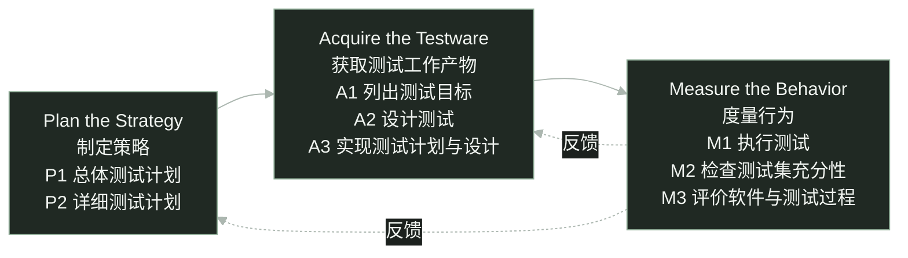

software testing / STEP

<h1 class="cover-title course-cover">STEP 模型 核心理念、测试过程与 Plate 实践</h1>

三个阶段、八项活动，测试怎样贯穿开发

sin6626 · 软件测试课程报告

<!--
大家好，今天介绍 STEP 模型。我们先看为什么测试需要提前介入，再介绍核心理念、三个阶段和八项活动，最后用 Plate 富文本编辑器重构的测试安排帮助理解。
这份报告区分模型本身的内容和课堂示例。退课需求是教学示例，Plate 是项目级辅助案例。Plate 部分依据二〇二六年十月十六日的固定资料快照，不代表今天的团队状态，也不声称团队正式采用了完整 STEP。
-->

---
glow: right
glowOpacity: 0.25
glowHue: 99
glowSeed: 205
clicks: 2
---

# 为什么需要 STEP？

等功能写完才开始测试，需求里的遗漏可能已经进入代码。

教学示例 · 假设退课截止时间为 18:00，以下规则尚待澄清。

<h2>试着设计边界用例</h2>

在 17:59、18:00、18:01 申请退课。

恰好 18:00，应该允许还是拒绝？

<h2>试着设计后续检查</h2>

退课成功后，检查课程剩余名额。

名额会释放吗？何时释放？

预期结果写不出来，就先把需求问清楚。

预防性测试思想 · <a href="https://api.pageplace.de/preview/DT0400.9781580537926_A25416955/preview-9781580537926_A25416955.pdf#page=35" target="_blank">Systematic Software Testing · pp.4–5</a> · 退课情境为教学示例

<!--
假设需求说学生可以在十八点以前退课。先试着列出十七点五十九分、十八点整和十八点零一分的用例。十八点整到底能不能退？如果规则没说清楚，就不能擅自编一个预期。
再检查退课后的名额。是否释放，什么时候释放，失败时怎么办，也需要需求负责人确认。我们设计测试时就发现了需求遗漏，可以在编码前反馈。
原始资料第四至五页用取款需求解释预防性测试。本页换成退课情境，业务规则仍是假设，不能当成已经确认的学校规定。
-->

---
glow: top-right
glowOpacity: 0.25
glowHue: 93
glowSeed: 306
clicks: 1
---

# STEP 的定义与定位

Systematic Test and Evaluation Process

系统化地组织测试与评价， 以预防性测试为导向。

测试规划、测试设计可以从开发早期开始。

作为测试过程的内容参考模型，说明有哪些活动、怎样组织。

同时评价软件表现与测试过程，为后续改进提供依据。

<a href="https://api.pageplace.de/preview/DT0400.9781580537926_A25416955/preview-9781580537926_A25416955.pdf#page=51" target="_blank">Systematic Software Testing · p.20</a> · <a href="https://istqb.org/wp-content/uploads/2024/11/CTAL_TM_2012_Syllabus_v2.0.pdf#page=62" target="_blank">ISTQB CTAL-TM 2012 · §5.7</a>

<!--
STEP 的全称是 Systematic Test and Evaluation Process，可以理解为系统化测试与评价过程。它以预防性测试为导向，组织策略制定、测试工作产物的获取，以及行为度量。
ISTQB 二〇一二年高级测试管理大纲把 STEP 作为内容参考模型介绍。这里强调测试过程需要包含哪些活动，不把它说成给组织评成熟度等级的模型。
STEP 也不等于 TDD。TDD 是先写失败测试、实现通过、再重构的开发循环。STEP 讨论整体测试如何组织，提前设计需求用例并不自动等于 TDD。TDD 的独立定义依据 Martin Fowler，https://martinfowler.com/bliki/TestDrivenDevelopment.html 。
参考原书第二十页和历史大纲第五点七节。原书说明测试规划从需求阶段开始，测试设计与软件设计并行。
-->

---
glow: bottom
glowOpacity: 0.3
glowHue: 87
glowSeed: 411
clicks: 2
---

# STEP 的核心理念

基本前提 · 按 ISTQB 2012 大纲 §5.7 的原文顺序逐项译述。

<ol>
<li>基于需求的测试策略。</li>
<li>测试从生命周期开始时介入。</li>
<li>测试用作需求和使用模型。</li>
<li>测试工作产物的设计引导软件设计。</li>
</ol>
<ol v-click="1" start="5">
<li>更早发现缺陷，或预防缺陷产生。</li>
<li>系统地分析缺陷。</li>
<li>测试人员与开发人员协作。</li>
</ol>

本报告的理解性概括 · 四点对应关系

① 以需求为测试依据 （第 1、3 项）

② 尽早介入、预防缺陷 （第 2、4、5 项）

③ 开发与测试协作 （第 7 项）

④ 分析缺陷，持续改进 （第 6 项＋M2/M3）

七项译述：<a href="https://istqb.org/wp-content/uploads/2024/11/CTAL_TM_2012_Syllabus_v2.0.pdf#page=63" target="_blank">ISTQB CTAL-TM 2012 · §5.7 · p.63 · basic premises</a> “持续改进”另据 M2/M3：<a href="https://api.pageplace.de/preview/DT0400.9781580537926_A25416955/preview-9781580537926_A25416955.pdf#page=45" target="_blank">Craig &amp; Jaskiel · 原书 p.14 · Table 1-3</a>。四点是本报告概括，非原文固定分组。

<!--
这里采用 ISTQB 二〇一二年测试经理大纲第五点七节的七项基本前提，顺序与该节原文一致。它是历史大纲对 STEP 的介绍。
第一项强调测试策略以需求为依据。第二项说明测试从生命周期开始时介入。第三项说明测试可以作为需求和使用方式的模型，通过具体场景表达期望的软件行为。
第四项强调先设计测试工作产物，用它们引导软件设计。在需求规格能够作为输入时，提前设计的测试可以暴露歧义和遗漏。
第五项说明测试关注更早发现和预防缺陷。第六项要求系统地分析缺陷。第七项强调测试人员与开发人员协作。
下方四点是本报告为理解而作的概括，不是原文规定的四大理念。第一点“以需求为测试依据”对应第一项与第三项：从需求出发，并通过测试描述需求和使用场景。
第二点“尽早介入、预防缺陷”对应第二、第四、第五项：从生命周期开始设计测试，用测试工作产物引导设计，更早发现或预防缺陷。第三点“开发与测试协作”直接对应第七项。
第四点“分析缺陷，持续改进”结合了两个来源。第六项直接支持的是系统分析缺陷，不能只凭这一条就推出完整的持续改进。“持续改进”还需要结合原书表一杠三：M2 检查测试集充分性，M3 评价软件与测试过程，才能解释发现不足、反馈并调整的思路。M2/M3 的活动名称是原文，持续改进是本报告对其用途的理解。
-->

---
class: step-flow-slide
glow: right
glowOpacity: 0.22
glowHue: 80
glowSeed: 511
clicks: 0
---

# STEP 整体流程

三个阶段、八项活动 · 活动结构不等于严格的执行时间线。

同一层级内、不同层级间，活动都可能交叠。

据 <a href="https://api.pageplace.de/preview/DT0400.9781580537926_A25416955/preview-9781580537926_A25416955.pdf#page=45" target="_blank">原书 p.14 · Table 1-3</a> 重绘活动结构；虚线反馈为说明性补充，非原表箭头。 活动交叠与时序依据 <a href="https://api.pageplace.de/preview/DT0400.9781580537926_A25416955/preview-9781580537926_A25416955.pdf#page=46" target="_blank">pp.15–16 · Figures 1-5 / 1-6</a>。

<!--
原书表一杠三把 STEP 分为三个阶段。制定策略包括总体测试计划与详细测试计划。获取测试工作产物包括列出目标、设计测试、实现计划与设计。度量行为包括执行、检查测试集充分性、评价软件与测试过程。
本页把表格中的活动改画成流程图，方便看清结构。实线说明阶段关系，不表示每个阶段必须全部结束，下一阶段才能开始。
虚线是为说明反馈关系添加的。例如评价后发现目标和设计不足，需要补充工作产物；安排有问题，需要修订计划。虚线不是原书图中已有的箭头。
原书第十五至十六页另外说明执行时机和活动交叠，第九页将单独展示这些时序特点。
-->

---
glow: right
glowOpacity: 0.22
glowHue: 74
glowSeed: 612
clicks: 1
---

# 制定策略 · 总体计划与详细计划

Plan the Strategy · 选择策略，确定测试层级和开展方式。

<h2>P1 制定总体测试计划</h2>

确定总体范围、风险与测试策略。

统筹测试层级、资源和职责。

Master test plan

<h2>P2 制定详细测试计划</h2>

细化对应层级的执行安排。

明确人员、环境、时间及开始和结束条件。

Detailed test plans

详细计划组织测试，A2 再设计具体测试。

<a href="https://api.pageplace.de/preview/DT0400.9781580537926_A25416955/preview-9781580537926_A25416955.pdf#page=45" target="_blank">原书 p.14 · Table 1-3</a>；层级与裁剪见 <a href="https://api.pageplace.de/preview/DT0400.9781580537926_A25416955/preview-9781580537926_A25416955.pdf#page=44" target="_blank">p.13 · Figure 1-4</a>。中文问题说明为译述。

<!--
Plan the Strategy 是原书的阶段名称，可以译为制定策略。原书第十四页说明，这一阶段选择策略，明确测试层级和方式。
P1 建立总体测试计划，统筹项目测试。P2 制定详细测试计划，把安排落实到对应测试层级。原书第十三页说明简单项目可能只需要一两个测试层级，复杂项目则可以有更多层级，具体按项目裁剪。
总体计划和详细计划的活动名称来自表一杠三，页面上的范围、风险、人员和环境等是对计划问题的解释，不是额外的 STEP 活动。
详细计划不等于详细用例。具体输入、操作与预期结果属于后面的测试设计。
-->

---
glow: left
glowOpacity: 0.25
glowHue: 68
glowSeed: 713
clicks: 2
---

# 获取测试工作产物 · 目标、设计与实现

Acquire the Testware · 包括测试文档、用例、数据、程序等。

A1

<h2>列出测试目标</h2>

需求、设计与实现为依据

识别并整理要测试的内容， 形成测试目标清单。

A2

<h2>设计测试</h2>

架构与环境，以及具体测试

设计测试架构与环境， 按需求、设计、实现设计测试。

A3

<h2>实现计划与设计</h2>

形成能够执行的测试工作产物

实现测试步骤和程序， 准备配套数据、文件与环境。

假设退课示例 · 先列截止时间目标，再设计边界检查，最后准备课程数据与执行步骤；规则仍需确认。

<a href="https://api.pageplace.de/preview/DT0400.9781580537926_A25416955/preview-9781580537926_A25416955.pdf#page=45" target="_blank">原书 p.14 · Table 1-3</a> · <a href="https://api.pageplace.de/preview/DT0400.9781580537926_A25416955/preview-9781580537926_A25416955.pdf#page=48" target="_blank">pp.17–19 · Work Products of STEP</a>

<!--
Acquire the Testware 可以译为获取测试工作产物。原书第十七页把 testware 定义为测试计划、测试规格、已实现的测试过程、测试用例和测试数据文件等测试产品。获取也包含分析、设计和实现这些产物，不能仅理解为安装工具。
A1 根据需求、设计和实现列出测试目标。A2 不只设计单条用例，还包括测试架构与环境，以及基于需求、设计和实现的测试设计。A3 将这些计划与设计落实为测试步骤、配套数据、文件、环境和必要的支持代码。
以假设退课系统为例，截止时间是一个目标；检查截止前、截止点和截止后是设计；准备课程数据、时间条件和可执行步骤是实现。设计和实现信息出现后，还可以补充接口、状态或代码层面的目标与测试。示例没有真实业务规格，预期结果要以确认后的规则为准。
-->

---
glow: top-right
glowOpacity: 0.25
glowHue: 62
glowSeed: 814
clicks: 2
---

# 度量行为 · 执行、充分性与评价

Measure the Behavior · 执行结果与测试覆盖需要分别检查。

M1

<h2>执行测试</h2>

实际表现符合预期吗？

执行测试、检查结果， 留下记录与问题报告。

M2

<h2>检查测试集充分性</h2>

测试与目标清单怎样对应？

检查需求、设计等清单 与测试的覆盖对应，识别遗漏。

M3

<h2>评价软件与测试过程</h2>

软件与测试过程分别怎样？

评价软件表现， 也评价测试过程与工作产物。

“覆盖已知”是相对于所列清单，不是所有缺陷都已覆盖。

<a href="https://api.pageplace.de/preview/DT0400.9781580537926_A25416955/preview-9781580537926_A25416955.pdf#page=45" target="_blank">原书 p.14 · Table 1-3</a> · 覆盖清单与校准见 <a href="https://api.pageplace.de/preview/DT0400.9781580537926_A25416955/preview-9781580537926_A25416955.pdf#page=51" target="_blank">pp.20–21</a>

<!--
M1 执行测试，检查实际结果并记录问题。M2 检查测试集是否充分。原书第二十至二十一页强调，应把测试与需求、设计、代码等目标清单建立对应，并相对这些清单度量覆盖。
因此用例全部通过与测试充分是不同的问题。目标清单本身遗漏了需求，即使用例覆盖了清单中的每一项，也不能推出遗漏的行为得到验证。
M3 同时评价软件和测试过程。软件目前表现怎样，测试设计、执行和记录又是否有效，需要分别作出有证据支持的评价。
原书表一杠三给出八项活动的名称；这里对充分性检查的解释同时依据第二十至二十一页的覆盖对应关系，不能把方法试验或用例通过率直接当成完整覆盖。
-->

---
glow: right
glowOpacity: 0.22
glowHue: 56
glowSeed: 915
clicks: 2
---

# 测试怎样贯穿软件开发？

同一测试层级内，活动依次展开并可交叠；图中长度不代表工期。

需求规格设计描述软件实现

制定计划

分析测试目标

设计测试

实现测试计划与设计

执行测试

检查测试集充分性

评价软件与测试过程

高层测试可以先设计、后执行；各层级的测试设计也可交叠。

据 <a href="https://api.pageplace.de/preview/DT0400.9781580537926_A25416955/preview-9781580537926_A25416955.pdf#page=47" target="_blank">原书 p.16 · Figure 1-6</a> 重绘；高层测试时序见 <a href="https://api.pageplace.de/preview/DT0400.9781580537926_A25416955/preview-9781580537926_A25416955.pdf#page=46" target="_blank">pp.15–16 · Figure 1-5</a>。 生命周期从需求形成延续到退役，见 <a href="https://istqb.org/wp-content/uploads/2024/11/CTAL_TM_2012_Syllabus_v2.0.pdf#page=62" target="_blank">ISTQB §5.7 · p.62</a>。

<!--
这幅可编辑时序图依据原书第十六页图一杠六重绘，保留活动依次展开、持续交叠的关系。条形长度不表示实际日期、投入或工期，开发输入也不是每项测试只能开始一次的硬性关卡。
计划和目标先展开，再设计测试和实现测试，随后执行、检查充分性并评价。活动可以交叠，不能理解成上一项全部结束后才能开展下一项。
原书第十五页强调，在被测组件的外部、功能或黑盒规格可用时，就能开始基于需求的测试设计，并争取在相应软件详细设计之前完成大部分测试设计。高层级的系统、验收测试以系统需求为输入，可以提前设计。随着设计细化，再补设计相关测试；编码时，再补实现相关测试。
原书第十六页也区分设计顺序与执行顺序。单元、集成、系统和验收测试的执行受到被测软件组装顺序的限制；规划和获取测试工作产物没有同样限制，高层测试集可以先开发、后使用。不同层级的目标分析与设计可以交叠。
历史 ISTQB 大纲第五点七节把生命周期范围写到系统退役。因此发布后仍需随变更维护相应测试，不能把测试贯穿开发理解为发布即结束。
-->

---
glow: bottom-right
glowOpacity: 0.25
glowHue: 49
glowSeed: 1016
clicks: 2
---

# STEP 的特点与优势

原书 Table 1-5 的比较维度 · 反映 2002 年出版时的论述。

<table class="lifecycle-table step-strengths">
<thead><tr><th>维度</th><th>原书列出的 STEP 特点</th></tr></thead>
<tbody>
<tr><td>目标</td><td>以预防缺陷与风险管理为导向。</td></tr>
<tr><td>规划时机</td><td>从需求定义时开始测试规划。</td></tr>
<tr><td>获取时机</td><td>从需求定义时开始获取测试工作产物。</td></tr>
<tr v-click="1"><td>覆盖</td><td>建立测试与目标清单的对应，覆盖相对于清单是已知的。</td></tr>
<tr v-click="2"><td>过程可见性</td><td>测试活动形成文档和工作产物，能够检查和评价。</td></tr>
</tbody>
</table>

提前反馈问题，并让测试结论有可检查的依据。

<a href="https://api.pageplace.de/preview/DT0400.9781580537926_A25416955/preview-9781580537926_A25416955.pdf#page=52" target="_blank">Craig &amp; Jaskiel · Systematic Software Testing (2002) · p.21 · Table 1-5</a> 此处译述 STEP 一列；原书的行业比较不代表今天整个行业的状况。

<!--
这一页逐项对应原书表一杠五的五个比较维度，介绍 STEP 一列的内容。
原书首先强调预防与风险管理，并主张从需求定义时开始规划和获取测试工作产物。提前进行测试设计，有机会在编码前发现需求和设计问题。
随后是已知覆盖，但原文明确限定为相对于列出的目标清单。测试与清单建立对应，才可以说明已经覆盖哪些目标。清单本身仍需要检查。
过程可见性来自各活动形成的工作产物，例如计划、清单、设计、测试集和报告；它们使过程可以被检查和评价。
这是二〇〇二年出版原书中的比较，不能把书中对当时常见行业做法的描述当成今天所有团队的现状，也不把这些特点说成本项目已经测得的收益。
-->

---
glow: left
glowOpacity: 0.25
glowHue: 43
glowSeed: 1117
clicks: 1
---

# STEP 的局限性与实施条件

实施需要投入，测试效果也有边界。

<h2>前期投入与心智负担</h2>

初期需要学习、规划与协调。 还要考虑测试目标、用例与资源。

<h2 class="mt-5">测试覆盖仍可能遗漏</h2>

测试依赖需求理解与目标清单。 清单有遗漏，也可能漏测。

<h2>测试资料需要持续维护</h2>

功能变化后，用例、数据和 预期结果也要检查、更新。

<h2 class="mt-5">具体做法仍需团队决定</h2>

测试方法、自动化范围和人员分工， 仍要结合项目选择。

依据 Craig &amp; Jaskiel《Systematic Software Testing》（2002）原文分析： <a href="https://api.pageplace.de/preview/DT0400.9781580537926_A25416955/preview-9781580537926_A25416955.pdf#page=44" target="_blank">p.13 · 按项目裁剪</a> · <a href="https://api.pageplace.de/preview/DT0400.9781580537926_A25416955/preview-9781580537926_A25416955.pdf#page=48" target="_blank">p.17 · 测试工作产物</a> · <a href="https://api.pageplace.de/preview/DT0400.9781580537926_A25416955/preview-9781580537926_A25416955.pdf#page=52" target="_blank">p.21 · 实施投入与覆盖边界</a>

<!--
本页依据原书实施要求与覆盖说明分析局限，不把四个方面称为原书规定的官方局限清单。
第一，前期投入与心智负担。第二十一页承认实施需要投入、落地存在难度。开发时还要组织测试目标、用例、资源和评价标准，因此初期需要学习、规划与协调。心智负担是对这些实施要求的通俗说明，没有量化测量，也不意味着项目总工作量一定增加；提前投入可能减少后期遗漏和返工。
第二，测试覆盖仍可能遗漏。第二十一页的已知覆盖是相对于目标清单而言。完整执行清单不等于涵盖全部重要场景，需求理解和目标清单本身仍可能有遗漏。
点击后看右栏。第三，测试资料需要持续维护。第十七页要求测试工作产物随软件并行发展，因此功能变化后，用例、数据和预期结果也需要检查、更新。这是持续维护成本。
第四，具体做法仍需团队决定。第十三页要求按具体项目裁剪、修订或扩展模型。采用什么方法、哪些场景自动化以及如何分工，仍需团队结合项目判断。
-->

---
glow: right
glowOpacity: 0.22
glowHue: 37
glowSeed: 1218
clicks: 2
---

# STEP 可以与其他模型配合吗？

ISTQB §5.7 明确提到 STEP 与 TPI Next 配合的实践。

<h2>STEP · 内容参考模型</h2>

说明测试过程有哪些活动， 以及各活动何时、怎样开展。

帮助具体描述和组织测试过程。

<h2>TPI Next · 成熟度视角</h2>

使用关键领域、检查点与成熟度模型， 评估测试过程并确定改进方向。

帮助了解当前状态和改进重点。

评估与改进方向，可以结合具体活动设计一起使用。

<a href="https://istqb.org/wp-content/uploads/2024/11/CTAL_TM_2012_Syllabus_v2.0.pdf#page=62" target="_blank">ISTQB CTAL-TM 2012 · §5.5 TPI Next / §5.7 STEP · pp.62–63</a> §5.7 记录了 STEP 评估模型与 TPI Next 成熟度模型结合的实践。

<!--
可以结合使用，但应先说明模型各自回答什么问题。ISTQB 二〇一二年大纲把 STEP 作为内容参考模型，关注具体活动及其开展方式。
同一份大纲第五点五节介绍 TPI Next，用关键领域、检查点和成熟度模型评估测试过程并组织改进。第五点七节明确记载，在某些情况下，STEP 评估模型会与 TPI Next 成熟度模型结合使用。
因此可以一边识别过程当前处于什么状态、需要优先改进什么，一边用具体测试活动落实改进。大纲只是记述结合实践，并未给出所有项目必须遵循的标准组合方法。
这页以这一个有直接出处的例子回答能否配合使用，不把内容参考模型与成熟度模型混为同一类别。
-->

---
glow: top-right
glowOpacity: 0.25
glowHue: 31
glowSeed: 1319
clicks: 1
---

# Plate 项目重构背景

Plate 富文本编辑器正在重构，团队为多个组件与编辑交互制定测试计划。

<h2>项目背景</h2>

重构涉及组件及其编辑行为。

光标、选区、焦点、菜单和布局， 都可能随操作顺序而变化。

<h2>测试任务</h2>

对照原有版本，检查共有功能是否保持。

单独检查新增功能是否符合预期。

按计划记录问题、修复并补充测试。

先看团队的原计划，再用 STEP 分析这些工作。

以下以 PR 对应版本为准（2026-10-16） · <a href="https://github.com/udecode/plate/pull/5175" target="_blank">PR #5175</a> · <a href="https://github.com/udecode/plate/blob/93bc5098cb2116a5ebade694f3706b1e9139499d/.agents/rules/verify/references/tester-pass.md#L7" target="_blank">页面范围与测试规则</a>

<!--
Plate 是富文本编辑器。这轮重构涉及多个组件与编辑交互，测试既要检查已有共有行为是否保持，也要检查新增行为是否符合预期。
共有功能的参考来源包括上游 Slate 示例和正式版 Plate。新增功能单独分配测试场次，不能把重构版新增的功能差异直接算作缺陷。与其他编辑器的能力差距则作为提案评价。
团队在 PR #5175 中制定了这轮测试的工作计划，包含准备工具和规则、开展首轮测试、评价方法、修复以及后续轮次。下一页先保留原计划的编号，再沿着首轮顺序解释 STEP 三个阶段和八项主要活动。
以下状态均以固定版本 93bc5098cb2116a5ebade694f3706b1e9139499d 为准，资料日期为二〇二六年十月十六日。我们用 STEP 理解这些工作体现的思想，不声称团队明确按照 STEP 命名设计，也不能由重构后的测试倒推已完整实施全生命周期预防性测试。
-->

---
glow: right
glowOpacity: 0.22
glowHue: 25
glowSeed: 1420
clicks: 2
---

# Plate 测试工作计划

保留 PR 原编号 · 首轮先准备，再执行、评价与修复。

<h2>已交付的工具与规则</h2>

1.1 修正问题报告的对照基准

1.2 输出测试源码 hash

1.3 建立 Issue 与回归测试关联规则

1.4 编写页面清单与加载检查脚本

1.5 编写测试人员指南

<h2>首轮待执行工作</h2>

1.6 准备植入缺陷的试验环境

1.7 编写首轮测试计划

1.8 执行首轮测试

1.9 评价首轮方法试验

1.10 修复问题并补充测试

1.11 汇总结果，作阶段决策

后续：2.1 接入浏览器回归 CI，2.2 评价改动，3.1～3.3 开展后续轮次或交接。

<a href="https://github.com/udecode/plate/blob/93bc5098cb2116a5ebade694f3706b1e9139499d/docs/plans/2026-10-15-regression-sweep.md#L220" target="_blank">原计划 · Phase 1 · 1.1～1.11</a> · <a href="https://github.com/udecode/plate/blob/93bc5098cb2116a5ebade694f3706b1e9139499d/docs/plans/2026-10-15-regression-sweep.md#L249" target="_blank">Phase 2 / Phase 3</a>

<!--
先看同事原计划的顺序和交付状态。固定版本将一点一到一点五标为完成，交付的是工具与规则，不代表首轮人工测试已经完成。
一点一修正问题报告中两份录像的对照基准标签。一点二输出每条测试自身的源码 hash，便于识别测试是否变化；hash 不证明测试正确。一点三要求修复测试关联已发布的 Issue，并记录覆盖它的测试路径、标题和 hash。一点四交付页面清单和加载检查脚本。一点五交付测试人员指南。
点击后看待执行的一点六到一点一一。一点六在独立预览中植入已知缺陷并隔离答案；私有预览不可行时，方法试验无结论，首轮改在正常 Beta 上自由探索。一点七编写实际首轮执行表。一点八执行、录屏、记录，并在整轮后复现发现。一点九由独立盲评者对照封存答案评价方法试验，必须在修复前完成。一点一零发布确认的问题、修复并补充能检出问题的测试。一点一一汇总发现与时间投入，形成阶段决策。
再次点击补充后续安排。二点一计划在第一个相应修复中接入 Plate 浏览器回归 CI 门禁，当前仍待完成。二点二根据证据决定保留、隔离还是撤回改动。三点一到三点三准备下一轮、执行与修复，再按条件重复或交接。后面三页主要沿首轮顺序分析，不用后续步骤跳跃拼接八项活动。
-->

---
glow: left
glowOpacity: 0.25
glowHue: 19
glowSeed: 1521
clicks: 2
---

# 测试规划

Planning · 从 PR 总计划，落实到首轮执行安排。

<h2>P1 制定总体测试计划</h2>

对应制定这份 PR 总计划。

确定测试范围、对照来源、 优先顺序与轮次规则。

总体规则已制定

<h2>P2 制定详细测试计划</h2>

对应 1.7 编写首轮计划。

落实页面、浏览器、方法组、 时间与已知问题复查安排。

首轮执行表待编排

总体计划确定方向，详细计划安排这一轮怎么做。

<a href="https://github.com/udecode/plate/blob/93bc5098cb2116a5ebade694f3706b1e9139499d/docs/plans/2026-10-15-regression-sweep.md#L220" target="_blank">PR 总计划</a> · <a href="https://github.com/udecode/plate/blob/93bc5098cb2116a5ebade694f3706b1e9139499d/docs/plans/2026-10-15-regression-sweep.md#L243" target="_blank">1.7 首轮计划</a> · <a href="https://github.com/udecode/plate/blob/93bc5098cb2116a5ebade694f3706b1e9139499d/.agents/rules/verify/references/tester-pass.md#L53" target="_blank">轮次编排规则</a>

<!--
这一页对应 Plan the Strategy。P1 首先体现在制定整份 PR 总计划这件事本身，不是只挑出一点五的指南编写，也不是把某个工具步骤单独叫总体计划。
这份计划确定了哪些页面和行为要测、共有行为对照什么、按照什么优先顺序安排、如何组织轮次，以及执行后如何评价和处理问题。它提供整轮测试的方向和规则。
P2 则直接对应一点七的首轮详细计划。负责人还需把页面与范围逐项列入场次表，分配浏览器、方法组和时间，安排已知问题复查，并预留准备、休息、记录和其他检查时间。
已有共有行为的场次八分钟，新增功能六分钟。页面在 Chrome、Safari、Firefox 和 iPhone 上错开，每一轮向后轮换。具体执行表仍待编排，规则已经写好不代表实际场次已经执行。
这两个层次是根据 STEP 活动分析其工作内容。原计划自身也使用 P1 等代号表示页面测试优先级，两套代号含义不同，讲解时不要混淆。我们在本页的 P1 和 P2 专指 STEP 活动。
-->

---
glow: top-right
glowOpacity: 0.25
glowHue: 12
glowSeed: 1622
clicks: 2
---

# 测试资源准备

Acquisition · 沿 1.1～1.6，把测试目标与方法落实为可用资源。

A1

<h2>列出测试目标</h2>

1.4 页面清单 · 已交付

列出要测的页面、范围， 以及对应的参考页面。

A2

<h2>设计测试</h2>

1.5 测试指南 · 已交付

规定操作方法、观察重点 与记录方式。

A3

<h2>实现计划与设计</h2>

1.6 试验环境 · 待准备

搭建可执行的独立预览， 准备植入的缺陷与数据。

1.1～1.3 提供配套规则：问题报告、源码追踪、Issue 与测试关联。

<a href="https://github.com/udecode/plate/blob/93bc5098cb2116a5ebade694f3706b1e9139499d/docs/plans/2026-10-15-regression-sweep.md#L222" target="_blank">1.1～1.6 准备工作</a> · <a href="https://github.com/udecode/plate/blob/93bc5098cb2116a5ebade694f3706b1e9139499d/.agents/rules/verify/references/tester-pass.md#L7" target="_blank">页面清单与测试指南</a>

<!--
这一页对应 Acquire the Testware，按一点一到一点六这段连续的准备工作来理解。最直观的例子是先明确测试目标，再设计方法，随后准备能够实际执行的环境和数据。
A1 对应一点四页面清单中明确测试页面、范围和参考来源的部分。页面是组织范围的一种方式，并不等于已经整理完整的需求与设计目标清单。页面加载检查也不能代替交互行为测试。
A2 对应一点五指南中设计操作方法、观察重点和记录方式的部分。指南规定计时录屏、观察光标、选区、焦点、菜单和布局，也给出六种候选操作方法；六种方法是否保留仍待首轮对照试验决定。
A3 以一点六的试验环境准备为例：建立独立预览，植入已知缺陷，准备页面分配和封存答案。固定版本中这一步仍未完成。它为后续人工执行和方法评价准备可使用的环境与数据。
这些对应说明各步骤的一部分工作内容，不是把原计划强行一一配对。比如一点四已经实现了脚本，一点五编写并交付指南也包含 A3 的实现工作；不能把指南的全部工作只限定为 A2。A2 同时包括测试架构和环境设计，也不限于指南中的操作方法。
一点一到一点三提供配套的问题报告、源码身份追踪和 Issue 与测试关联规则。源码 hash 只帮助识别测试变化，不能证明测试足够或测试正确。已交付的一点四和一点五，与待准备的一点六，状态在正文分别标明。
-->

---
glow: left
glowOpacity: 0.25
glowHue: 6
glowSeed: 1723
clicks: 2
---

# 测试执行与评估

Measurement · 首轮 1.8～1.11 仍待执行，测量结果将反馈到下一轮。

M1

<h2>执行测试</h2>

1.8 首轮执行

实际操作并录屏， 记录异常与复查结果。

M2

<h2>检查测试集充分性</h2>

核对目标与测试覆盖

用页面、场次与复查记录 核对遗漏。 完整覆盖校准仍需补充。

M3

<h2>评价软件与测试过程</h2>

1.9 方法评分 · 1.11 汇总决策

评价测试方法的发现能力， 汇总本轮问题与时间投入。

1.10 修复并补测试，将结果反馈到开发与资源准备，再调整下一轮计划。

<a href="https://github.com/udecode/plate/blob/93bc5098cb2116a5ebade694f3706b1e9139499d/docs/plans/2026-10-15-regression-sweep.md#L244" target="_blank">1.8～1.11 执行、评价与修复</a> · <a href="https://github.com/udecode/plate/blob/93bc5098cb2116a5ebade694f3706b1e9139499d/.agents/rules/verify/references/tester-pass.md#L47" target="_blank">已知问题复查规则</a>

<!--
这一页对应 Measure the Behavior，主要沿首轮一点八到一点一一展开。这些步骤在固定版本中仍待执行，不能把计划中的录屏、发现或方法评价写成实际结果。
M1 对应一点八实际开展测试。测试者按首轮计划进行计时录屏，现场探索并记录异常时间点；整轮之后在正常 Beta 上复现发现，保留参考来源与实际结果。
M2 检查测试集充分性，要把测试目标清单与测试对应起来，发现遗漏。原计划的页面清单、场次安排和已知问题复查记录可用于核对计划范围，但没有完整的需求与设计目标到测试的覆盖校准证据。因此这里说明如何联系 M2，同时明确仍需补充，不给它硬配一个任务编号。尤其不能把一点九的盲评直接称为 M2，那主要评价的是测试方法。
M3 对应一点九和一点一一。一点九由独立盲评者对照封存的植入缺陷答案，比较六种候选操作与自由探索，在修复开始前作方法保留决策。一点一一按优先级、浏览器和操作方法汇总发现，以及每页每分钟发现与实际时间投入，形成阶段决策。这些分别体现评价测试过程和评价本轮软件表现。
中间的一点一零根据发现修复并补充能检出问题的测试，是测量结果反馈到开发和测试资源准备，不属于 M1 的执行本身。修复前先发布确认的问题，使测试可以关联 Issue。测试退出对应人工复查还需要满足源码、有效门禁及相应浏览器覆盖等条件。
评价结果用于调整计划、指南和下一轮安排；下一轮须等 Beta 已包含本轮修复再开展。后续的浏览器回归 CI 门禁仍待接入，本页没有实际通过数字、已验证的方法优劣或整体节省时间的结论。
-->

---
layout: center
glow: bottom
glowOpacity: 0.35
glowHue: 0
glowSeed: 1824
clicks: 0
---

<h1 class="cover-title">谢谢大家</h1>

<!--
谢谢大家。
-->
