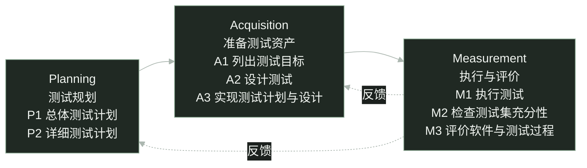

software testing / STEP

<h1 class="cover-title course-cover">STEP 模型 核心理念、测试过程与 Plate 实践</h1>

三个阶段、八项活动，测试怎样贯穿开发

sin6626 · 软件测试课程报告

<!--
大家好，今天介绍 STEP 模型。我们先看为什么测试需要提前介入，再介绍核心理念、三个阶段和八项活动，最后用 Plate 富文本编辑器重构的测试安排帮助理解。
这份报告区分模型本身的内容和课堂示例。退课需求是教学示例，Plate 是项目级辅助案例。Plate 部分依据二〇二六年十月十六日的固定资料快照，不代表今天的团队状态，也不声称团队正式采用了完整 STEP。
-->

---
glow: right
glowOpacity: 0.25
glowHue: 99
glowSeed: 205
clicks: 2
---

# 为什么需要 STEP？

等功能写完才开始测试，需求里的遗漏可能已经进入代码。

教学示例 · 假设退课截止时间为 18:00，以下规则尚待澄清。

<h2>试着设计边界用例</h2>

在 17:59、18:00、18:01 申请退课。

恰好 18:00，应该允许还是拒绝？

<h2>试着设计后续检查</h2>

退课成功后，检查课程剩余名额。

名额会释放吗？何时释放？

预期结果写不出来，就先把需求问清楚。

预防性测试思想 · <a href="https://api.pageplace.de/preview/DT0400.9781580537926_A25416955/preview-9781580537926_A25416955.pdf#page=34" target="_blank">Systematic Software Testing · pp.4–5</a> · 退课情境为教学示例

<!--
假设需求说学生可以在十八点以前退课。先试着列出十七点五十九分、十八点整和十八点零一分的用例。十八点整到底能不能退？如果规则没说清楚，就不能擅自编一个预期。
再检查退课后的名额。是否释放，什么时候释放，失败时怎么办，也需要需求负责人确认。我们设计测试时就发现了需求遗漏，可以在编码前反馈。
原始资料第四至五页用取款需求解释预防性测试。本页换成退课情境，业务规则仍是假设，不能当成已经确认的学校规定。
-->

---
glow: top-right
glowOpacity: 0.25
glowHue: 93
glowSeed: 306
clicks: 1
---

# STEP 的定义与定位

Systematic Test and Evaluation Process

系统化地组织测试与评价， 以预防性测试为导向。

测试规划、测试设计可以从开发早期开始。

作为测试过程的内容参考模型，说明有哪些活动、怎样组织。

同时评价软件表现与测试过程，为后续改进提供依据。

<a href="https://api.pageplace.de/preview/DT0400.9781580537926_A25416955/preview-9781580537926_A25416955.pdf#page=50" target="_blank">Systematic Software Testing · p.20</a> · <a href="https://istqb.org/wp-content/uploads/2024/11/CTAL_TM_2012_Syllabus_v2.0.pdf#page=62" target="_blank">ISTQB CTAL-TM 2012 · §5.7</a>

<!--
STEP 的全称是 Systematic Test and Evaluation Process，可以理解为系统化测试与评价过程。它以预防性测试为导向，组织测试规划、测试资源准备、执行和评价。
ISTQB 二〇一二年高级测试管理大纲把 STEP 作为内容参考模型介绍。这里强调测试过程需要包含哪些活动，不把它说成给组织评成熟度等级的模型。
STEP 也不等于 TDD。TDD 是先写失败测试、实现通过、再重构的开发循环。STEP 讨论整体测试如何组织，提前设计需求用例并不自动等于 TDD，两者可以配合。
参考原书第二十页和历史大纲第五点七节。原书说明测试规划从需求阶段开始，测试设计与软件设计并行。
-->

---
glow: bottom
glowOpacity: 0.3
glowHue: 87
glowSeed: 411
clicks: 2
---

# STEP 的核心理念

以下是依据原始资料整理的课堂概括。

<h2>以需求为测试依据</h2>

从需求确定目标和预期，发现歧义就反馈。

<h2 class="mt-7">从生命周期早期开始</h2>

需求出现时就能规划和设计测试。

<h2>开发与测试协作</h2>

开发逐步提供信息，测试及时提出问题。

<h2 class="mt-7">分析结果，持续改进</h2>

既评价软件，也检查测试是否充分有效。

测试设计本身，就能帮助发现开发产物中的问题。

课堂概括，非官方条目穷举 · <a href="https://istqb.org/wp-content/uploads/2024/11/CTAL_TM_2012_Syllabus_v2.0.pdf#page=62" target="_blank">ISTQB CTAL-TM 2012 · §5.7</a> · <a href="https://api.pageplace.de/preview/DT0400.9781580537926_A25416955/preview-9781580537926_A25416955.pdf#page=50" target="_blank">原书 p.20</a>

<!--
这四点是为了课堂讲解整理的概括，不是原书给出的全部原则清单。
以需求为依据，意味着预期结果要有来源。需求不清楚时，先澄清，而不是把测试者的猜测当成正确答案。
从生命周期早期开始，是说可以提前规划和设计，不意味着还没有可运行软件时就能执行真实界面测试。开发和测试协作，让这些设计发现的问题能够及时反馈。
最后还要分析测试结果，评价软件与测试过程。测试没有发现问题，可能是软件表现正常，也可能是测试目标和方法有遗漏，需要分别判断。
-->

---
class: step-flow-slide
glow: right
glowOpacity: 0.22
glowHue: 80
glowSeed: 511
clicks: 0
---

# STEP 整体流程

三个阶段、八项活动，评价结果反馈到计划和测试资源。

活动可重叠、可反复，不是开发结束后的单次流水线。

<a href="https://api.pageplace.de/preview/DT0400.9781580537926_A25416955/preview-9781580537926_A25416955.pdf#page=44" target="_blank">Systematic Software Testing · p.14 · Table 1-3</a> · 反馈线为课堂概括

<!--
这是本报告的整体流程图。实线从 Planning 到 Acquisition，再到 Measurement，分别组织规划、资源准备、执行与评价。每个节点里列出了原书表一杠三的活动，总共八项。
P1 制定总体计划，P2 制定详细计划。A1 列出测试目标，A2 设计测试，A3 实现计划与设计。M1 执行测试，M2 检查测试集充分性，M3 评价软件与测试过程。
虚线表示评价后的反馈。发现目标和用例遗漏，可以回到 A。发现范围、策略、人员和时间安排有问题，可以回到 P。这些箭头是课堂概括，不是原书图的逐像素复刻。
实际活动可以重叠，不同模块与测试层级也可以分别进行。接下来逐个看三个阶段解决什么问题。
-->

---
glow: right
glowOpacity: 0.22
glowHue: 74
glowSeed: 612
clicks: 1
---

# Planning · 总体计划与详细计划

先决定测什么、为什么测，再安排怎样组织这一轮测试。

<h2>P1 制定总体测试计划</h2>

范围是什么？哪些风险优先？

统筹策略、测试层级、资源与职责。

产物 · 总体测试计划

<h2>P2 制定详细测试计划</h2>

由谁、何时、在哪种环境开展？

细化各测试层级的安排与进入、结束条件。

产物 · 相应层级的详细测试计划

具体输入、操作与预期结果，留到 A2 设计测试。

<a href="https://api.pageplace.de/preview/DT0400.9781580537926_A25416955/preview-9781580537926_A25416955.pdf#page=44" target="_blank">P1 / P2 · Systematic Software Testing · p.14</a> · 问题与产物为课堂译述

<!--
P1 从整个项目考虑范围和风险，决定总体策略、测试层级、资源和职责。它形成总体测试计划，为后续工作提供方向。
P2 把安排细化到对应测试层级。例如谁来执行系统测试，环境怎样准备，什么条件可以开始，达到什么条件可以结束。单元、集成、系统和验收测试可以有各自的详细安排。
详细计划不等于详细用例。计划回答怎样组织测试，某一条用例具体输入什么、怎样操作、预期是什么，属于后面的测试设计。实际项目可以精简文档形式，但这些决策仍要有人负责。
-->

---
glow: left
glowOpacity: 0.25
glowHue: 68
glowSeed: 713
clicks: 2
---

# Acquisition · 把目标变成可执行资源

通用需求示例 · 先确认退课规则，再设计和准备测试。

A1

<h2>列出测试目标</h2>

要检查什么？

截止时间的处理， 成功退课后的名额变化。

产物 · 测试目标清单

A2

<h2>设计测试</h2>

怎样检查，依据是什么？

设计边界输入与状态检查， 预期以确认后的规则为准。

产物 · 条件、步骤与预期

A3

<h2>实现计划与设计</h2>

把执行条件准备好

准备账号、课程和时间环境， 实现脚本或人工操作说明。

产物 · 可使用的测试资源

<a href="https://api.pageplace.de/preview/DT0400.9781580537926_A25416955/preview-9781580537926_A25416955.pdf#page=44" target="_blank">A1 / A2 / A3 · 原书 p.14</a> · <a href="https://api.pageplace.de/preview/DT0400.9781580537926_A25416955/preview-9781580537926_A25416955.pdf#page=47" target="_blank">testware · p.17</a> · 退课为教学示例

<!--
Acquisition 在原书中叫 Acquire Testware。testware 指测试活动形成的文档和产品，例如计划、用例、数据和脚本，所以资源准备不只是安装工具。
A1 列出目标，本例包括截止时间的处理和退课后名额的变化。A2 再为目标设计输入、步骤和预期。例如检查截止前、截止点和截止后的申请，并检查成功退课后的课程状态。规则没有确认，就先澄清，不能编预期。
A3 把这些设计落实成可用的资源。准备测试账号、课程数据和可控的时间环境，实现自动脚本，或写清人工执行说明和记录方式。这些都是教学中的准备建议，不表示已经有真实退课系统或已经执行。
-->

---
glow: top-right
glowOpacity: 0.25
glowHue: 62
glowSeed: 814
clicks: 2
---

# Measurement · 执行、查充分性、作评价

用例通过以后，还要判断覆盖了什么、遗漏了什么。

M1

<h2>执行测试</h2>

实际表现符合预期吗？

执行操作、对照预期， 记录结果与异常。

M2

<h2>检查测试集充分性</h2>

测试目标覆盖得够吗？

对照目标与覆盖准则， 结合风险检查遗漏。

M3

<h2>评价软件与测试过程</h2>

产品与测试分别怎样？

软件还有哪些质量风险？ 测试方法与安排怎样改进？

已通过的用例，只能支持它们所检查的行为。

<a href="https://api.pageplace.de/preview/DT0400.9781580537926_A25416955/preview-9781580537926_A25416955.pdf#page=44" target="_blank">M1 / M2 / M3 · Systematic Software Testing · p.14</a>

<!--
M1 是执行测试并记录结果。M2 要检查现有测试集是否充分，例如每个需求目标有没有对应测试，高风险边界有没有遗漏，覆盖准则是否满足。不能只看用例通过率。
M3 有两个评价对象。评价软件，要根据证据判断已发现的问题和剩余质量风险。评价测试过程，要看目标、方法、资源和安排是否有效。
如果发现遗漏，就补充设计再执行。如果方法或资源有问题，就调整 A 阶段。如果范围、策略或时间不合适，就调整 P 阶段。没有发现缺陷不能直接推出没有缺陷。
-->

---
glow: right
glowOpacity: 0.22
glowHue: 56
glowSeed: 915
clicks: 2
---

# 测试怎样贯穿软件开发？

开发产物逐渐明确，测试活动也随之展开。

<table class="lifecycle-table">
<thead><tr><th>开发进程</th><th>开发在做什么</th><th>测试可以做什么</th></tr></thead>
<tbody>
<tr><td>需求形成</td><td>明确功能与业务规则</td><td>规划测试，列出目标，提前设计需求用例</td></tr>
<tr v-click="1"><td>软件设计</td><td>确定结构、接口与交互</td><td>补充设计相关测试，反馈遗漏与歧义</td></tr>
<tr v-click="1"><td>编码实现</td><td>实现和集成模块</td><td>补充代码相关测试，准备脚本、数据和环境 有可运行模块，就能开展相应的 M1</td></tr>
<tr v-click="2"><td>版本可运行</td><td>交付版本，处理发现</td><td>继续执行，检查充分性，评价软件与测试过程</td></tr>
</tbody>
</table>

活动可以重叠；需求变化时，计划和测试资源也要更新。

课堂概括，非开发阶段与测试活动的一一对应 · <a href="https://api.pageplace.de/preview/DT0400.9781580537926_A25416955/preview-9781580537926_A25416955.pdf#page=45" target="_blank">Systematic Software Testing · pp.15–17、20</a>

<!--
这张表按开发进程帮助理解，但不能把某一项测试活动固定在某一行。需求形成时，就可以规划并设计基于需求的测试，发现歧义后及时反馈。
软件设计时补充与结构、接口和交互有关的测试。编码时继续补充实现相关测试，并准备数据、环境与脚本。有可运行模块时，就能执行相应的 M1，不必等整个版本都结束开发。
版本可运行以后，仍要执行、检查充分性并评价。不同模块、迭代和测试层级可以重叠开展。P、A、M 都可能随着新信息和反馈反复进行。
提前设计真实界面的用例，与已经能够运行真实界面测试，是不同的事情。原书第十五至十七页说明活动时间与测试工作产物，第二十页强调测试规划从需求阶段开始，并行开展测试设计。历史 ISTQB 大纲还说明这种方法贯穿需求形成直到系统退役，发布后发生变更仍要持续测试并更新测试资产。
-->

---
glow: bottom-right
glowOpacity: 0.25
glowHue: 49
glowSeed: 1016
clicks: 2
---

# STEP 的优点

从模型的活动安排，看它能怎样帮助测试工作。

01

<h2>及早澄清问题</h2>

设计测试也能发现遗漏

需求尚在讨论时， 就检查规则与预期是否明确。

02

<h2>产物与依据清楚</h2>

目标、设计、执行可衔接

说明为何检查、怎样检查， 以及结论依据什么。

03

<h2>持续评价与改进</h2>

同时关注软件与测试过程

根据遗漏和执行结果， 调整计划与测试资源。

这些安排支持发现和管理风险，不保证软件没有 Bug。

基于模型特点的课堂分析 · <a href="https://api.pageplace.de/preview/DT0400.9781580537926_A25416955/preview-9781580537926_A25416955.pdf#page=44" target="_blank">原书 pp.14–20</a>

<!--
这些优点是根据模型特点作出的课堂分析，不是本报告测得的项目收益。
提前设计测试，可以帮助需求讨论尽早发现歧义。目标、设计和记录相互衔接，也有助于说明测试结论的依据。M2 和 M3 则要求我们继续检查遗漏，评价软件和测试过程，避免执行完就结束。
这些安排并不能保证没有 Bug。实际效果仍取决于目标是否合适、设计是否有效，以及执行和评价是否落实。
-->

---
glow: left
glowOpacity: 0.25
glowHue: 43
glowSeed: 1117
clicks: 1
---

# 局限性与实施条件

以下是基于模型特点的分析。

<h2>需要持续维护测试资产</h2>

需求变化时，目标、用例、数据和脚本都要更新。

<h2 class="mt-7">需要协作与投入</h2>

规划、准备、执行和评价都需要人员与时间。

<h2>效果受设计质量影响</h2>

目标遗漏或预期错误，仍可能漏掉重要问题。

<h2 class="mt-7">需要具体技术与工具</h2>

模型组织活动，项目仍要选择方法并落实执行。

课堂分析，非原书的局限性原文清单 · 依据 <a href="https://api.pageplace.de/preview/DT0400.9781580537926_A25416955/preview-9781580537926_A25416955.pdf#page=44" target="_blank">原书 pp.14–20</a>

<!--
从实施条件看，STEP 需要维护测试工作产物。需求变化后，如果目标、预期或脚本仍是旧版本，系统化的形式也不能保证结论可靠。运行维护期间发生变更，也要持续更新测试资产。
活动还需要投入。开发和测试要协作，安排执行与评价的时间，不能只有一份计划却没有人维护。
测试效果也受目标与设计质量影响。错误的预期可能把缺陷当成正确行为，遗漏的目标可能根本没有被测试。STEP 提供活动组织方式，项目仍要选择合适的设计技术、工具和覆盖准则。
这里不推出 STEP 不适合敏捷，也不要求冻结全部需求。活动可以随迭代和反馈更新，具体怎样落地要结合项目。
-->

---
glow: right
glowOpacity: 0.22
glowHue: 37
glowSeed: 1218
clicks: 2
---

# 怎样与其他模型、策略和技术配合？

它们回答不同层次的问题，可以一起使用。

层次与例子

主要回答什么

怎样配合 STEP

过程视角 · V 模型

开发产物对应哪些测试层级？

帮助明确测试依据与层级

策略 · 基于风险

先测什么，投入多少？

帮助 Planning 排优先级

设计技术 · 边界值等

怎样选择输入与场景？

帮助 Acquisition 设计测试

执行方式 · 探索与自动化

怎样开展和重复检查？

准备资源，支持执行与记录

课堂配合示意，非模型优劣排名 · <a href="https://istqb.org/wp-content/uploads/2024/11/CTAL_TM_2012_Syllabus_v2.0.pdf" target="_blank">ISTQB CTAL-TM 2012 · 风险与测试过程</a> · <a href="https://api.pageplace.de/preview/DT0400.9781580537926_A25416955/preview-9781580537926_A25416955.pdf#page=44" target="_blank">STEP 活动依据</a>

<!--
这里选几个熟悉的例子说明层次差异，不做所有测试理论的比较。V 模型强调开发产物与相应测试层级的关系，可以帮助明确测试依据。STEP 关注如何组织规划、资源准备、执行和评价。
基于风险的策略帮助 Planning 决定先测什么、资源怎样分配。边界值分析等设计技术帮助 Acquisition 选择输入与场景，例如退课时间的边界。
探索测试与自动化支持具体执行。探索测试中设计和执行可以交织进行，自动化还需要在资源准备时实现脚本，两者并不是 Measurement 的专属工具。
还要区分内容参考模型和成熟度模型。STEP 说明过程内容，成熟度模型主要用于评价和改进过程能力。历史 ISTQB 大纲还提到 STEP 与 TPI Next 结合的实例，不能把两者混成同一种模型。
-->

---
glow: top-right
glowOpacity: 0.25
glowHue: 31
glowSeed: 1319
clicks: 1
---

# Plate 重构项目背景

富文本编辑器重构，风险分布在多个页面和组件交互中。

<h2>要检查什么？</h2>

共有功能是否保持，新功能是否符合预期。

编辑时的光标、选择、焦点和布局是否正常。

<h2>资料主要记录什么？</h2>

页面范围、测试准备、人工探索与问题追踪。

怎样把发现转成修复、测试和下一轮改进。

用 STEP 分析这些流程点，不等于项目正式全程采用 STEP。

2026-10-16 固定快照 · <a href="/evidence/plate-work-readme.md" target="_blank">Plate 行动指南</a> · <a href="/evidence/plate-source-status.md" target="_blank">来源与状态</a>

<!--
Plate 是富文本编辑器，重构涉及多个页面和组件。单个按钮可以操作，不代表把它放进表格、媒体、菜单或复杂选择中仍然正常，所以测试需要关注交互组合、光标、选择、焦点和布局。
接下来五页用项目级的多个流程点对应 STEP，内容主要是测试如何组织和改进，不围绕一个 Bug 展开。
这些资料是二〇二六年十月十六日保存的快照。我们没有据此确认今天的状态，也不能由测试准备记录倒推原始功能开发前已经开展预防性测试，更不声称团队正式采用了完整 STEP 生命周期。
-->

---
glow: right
glowOpacity: 0.22
glowHue: 25
glowSeed: 1420
clicks: 2
---

# Plate 的测试规划

对应 Planning · 把页面范围和测试策略落实到执行安排。

<h2>总体范围与策略</h2>

列出页面与功能范围，按风险安排优先级。

共有功能对照 Slate 或正式版 Plate。

新功能先确认预期，不能只凭版本差异判错。

<h2>详细执行安排</h2>

明确人员分工、页面、浏览器和测试时长。

安排方法组、已知问题复测与记录方式。

确认实际地址、环境与进入条件。

快照中的分工仍待批准，执行表与环境仍需确认。

2026-10-16 方案状态 · <a href="/evidence/plate-work-readme.md" target="_blank">行动指南 · 二、五、六</a> · <a href="/evidence/plate-source-status.md" target="_blank">使用边界</a>

<!--
对应 Planning，先看整体范围和策略。资料区分共有功能与新功能。共有功能有 Slate 或正式版 Plate 作为对照；新功能没有旧版对照时，需要依据明确需求和设计判断，差异本身不等于缺陷。
再看详细安排。需要把页面和范围分给人员，安排浏览器、方法组、时间和已知问题复测，并确认测试地址和环境。
二〇二六年十月十六日快照中的双人分工提案仍等待 Ziad 批准，浏览器、方法组和实际预览地址没有在个人清单中确定，不能说正式测试已经开始。
Plate 资料中的 P1 到 P6 是测试与修复的优先顺序，和 STEP 的 P1 总体计划、P2 详细计划不是同一套编号。本页使用优先级文字，避免混淆。
-->

---
glow: left
glowOpacity: 0.25
glowHue: 19
glowSeed: 1521
clicks: 2
---

# Plate 的测试资源准备

对应 Acquisition · 把测试目标和方法落实到可用资源。

<h2>快照已有准备记录</h2>

页面清单、测试人员指南与记录模板。

页面健康检查脚本、Issue 草稿流程。

Issue 与测试路径、标题、源码 hash 的关联。

<h2>正式执行前仍需确认</h2>

获批分工、轮次执行表和可用测试环境。

账号、数据、录屏与设备条件。

若开展方法试验，还需独立预览与密封答案。

准备有记录，不代表验证全绿，也不代表编辑交互已通过。

2026-10-16 固定快照 · <a href="/evidence/plate-work-readme.md" target="_blank">行动指南 · 三至五</a> · <a href="/evidence/plate-test-plan.md" target="_blank">总计划 · 1.1–1.7</a> · <a href="/evidence/plate-source-status.md" target="_blank">使用边界</a>

<!--
对应 Acquisition，清单帮助明确目标，指南提供操作和观察方法，模板帮助留下记录，脚本支持环境和页面检查。这些资源不是同一种东西，也不能单靠安装工具完成准备。
资料记录了步骤一点一到一点五的工具与流程准备，包括报告工具、测试源码 hash、Issue 与测试的关联、页面健康检查和指南。但来源状态明确说明部分验证有失败或范围限制，不能说所有检查全绿。
健康检查主要发现页面加载、报错、四〇四和应有编辑器缺失，不证明所有编辑交互正常。hash 能识别测试源码变化，本身不证明测试设计正确。
正式执行仍需确认分工、执行表、设备、数据和环境。若开展植入缺陷的方法试验，还要有隔离的预览和密封答案。这些在快照中仍是待确认事项。
-->

---
glow: top-right
glowOpacity: 0.25
glowHue: 12
glowSeed: 1622
clicks: 2
---

# Plate 的执行流程

对应 M1 · 以下是计划中的流程，不是已经完成的测试结果。

01

<h2>按计划探索</h2>

页面、范围、浏览器和时长

计时人工操作，观察编辑表现， 录屏并记录异常时间点。

02

<h2>整轮后复查</h2>

回到正常 Beta

复查异常是否仍可复现， 核对对照来源与实际结果。

03

<h2>确认问题报告</h2>

证据、预期与复现步骤

整理 Issue 草稿，人工核对， 确认发布后再进入修复。

正式测试先记发现，完成整轮后再改产品代码。

2026-10-16 待执行安排 · <a href="/evidence/plate-test-guide.md" target="_blank">Tester pass · A session / Find notes / After a round</a> · <a href="/evidence/plate-work-readme.md" target="_blank">行动指南 · 二</a>

<!--
计划中的一场测试，是对一个页面和范围，在指定浏览器内开展的计时录屏访问。测试者现场选择下一步，并观察光标、选择、焦点、菜单位置和布局。发现异常时记录录屏时间点，不能为了恢复焦点而补点鼠标，掩盖异常。
如果这一轮使用带已知问题的预览，整轮结束后再到正常 Beta 复查，区分人为植入的问题与正常产品的问题。可复现的异常整理成 Issue 草稿，人工核对预期和证据后发布。
资料要求先完成整轮场次，再进入修复，避免正式测试途中改产品导致后续页面面对不同版本。这里讲的是快照中的安排，没有报告已经执行的次数、通过率或缺陷数。
-->

---
glow: left
glowOpacity: 0.25
glowHue: 6
glowSeed: 1723
clicks: 2
---

# Plate 的评价与改进

对应 M2 / M3 · 评价软件问题，也评价测试方法是否有效。

<h2>方法评价方案 · 待执行</h2>

独立预览植入已知 Bug，答案密封保存。

同等时间比较候选方法与自由探索。

独立评分，再决定方法是否保留。

<h2>问题与回归改进 · 按计划</h2>

确认问题，修复并补能检出该问题的测试。

满足对应层级、浏览器的 CI 覆盖条件后， 才减少该问题的人工复测。

修复进入 Beta 后，再安排下一轮。

用遗漏与结果更新目标、资源和计划，再开始下一轮。

2026-10-16 方案快照，无方法优劣结论 · <a href="/evidence/plate-test-plan.md" target="_blank">总计划 · Round 1's planted-bug trial / 1.9–1.11</a> · <a href="/evidence/plate-test-guide.md" target="_blank">Rechecks</a>

<!--
M2 检查目标与风险是否遗漏，不能只看已执行用例通过。植入的已知问题如果没有被发现，可以提示方法或场景存在缺口，但不能代表所有真实风险。
M3 同时评价产品与测试过程。产品方面，在正常 Beta 复查并确认问题。过程方面，方案准备带已知 Bug 的独立预览和密封答案，在相同时间、浏览器安排和记录条件下比较候选方法与自由探索，由独立评分者对照答案。这个试验在快照中仍待执行，没有方法优劣结论。
确认问题后，要修复并补充能检出缺陷的测试。人工复测只有在测试存在、未跳过、源码身份匹配，并且 CI 在缺陷对应层级或更高层级覆盖后，才按计划减少。浏览器层问题还需要覆盖该问题涉及的浏览器；只有脚本或只有本地通过都不够。测试变化、被删除或失去门禁时，还需要重新检查是否恢复人工复测。
这不等于减少所有探索时间。修复进入 Beta 后才能进入下一轮，根据结果更新范围、目标、资源与安排，形成对 P 和 A 的反馈。以上是计划和课堂分析，不是已完成的项目收益。
-->

---
layout: center
glow: bottom
glowOpacity: 0.35
glowHue: 0
glowSeed: 1824
clicks: 0
---

<h1 class="cover-title">谢谢大家</h1>

<!--
谢谢大家。
-->
