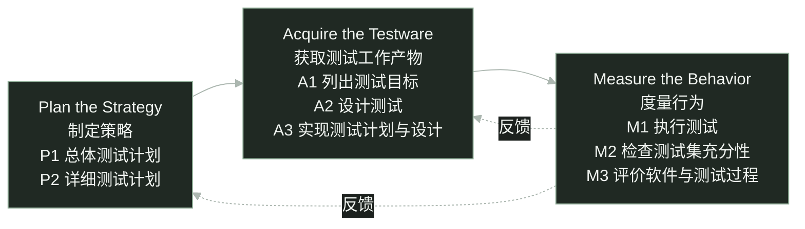

software testing / STEP

<h1 class="cover-title course-cover">STEP 模型 核心理念、测试过程与 Plate 实践</h1>

三个阶段、八项活动，测试怎样贯穿开发

sin6626 · 软件测试课程报告

<!--
大家好，今天介绍 STEP 模型。我们先看为什么测试需要提前介入，再介绍核心理念、三个阶段和八项活动，最后用 Plate 富文本编辑器重构的测试安排帮助理解。
这份报告区分模型本身的内容和课堂示例。退课需求是教学示例，Plate 是项目级辅助案例。Plate 部分依据二〇二六年十月十六日的固定资料快照，不代表今天的团队状态，也不声称团队正式采用了完整 STEP。
-->

---
glow: right
glowOpacity: 0.25
glowHue: 99
glowSeed: 205
clicks: 2
---

# 为什么需要 STEP？

等功能写完才开始测试，需求里的遗漏可能已经进入代码。

教学示例 · 假设退课截止时间为 18:00，以下规则尚待澄清。

<h2>试着设计边界用例</h2>

在 17:59、18:00、18:01 申请退课。

恰好 18:00，应该允许还是拒绝？

<h2>试着设计后续检查</h2>

退课成功后，检查课程剩余名额。

名额会释放吗？何时释放？

预期结果写不出来，就先把需求问清楚。

预防性测试思想 · <a href="https://api.pageplace.de/preview/DT0400.9781580537926_A25416955/preview-9781580537926_A25416955.pdf#page=35" target="_blank">Systematic Software Testing · pp.4–5</a> · 退课情境为教学示例

<!--
假设需求说学生可以在十八点以前退课。先试着列出十七点五十九分、十八点整和十八点零一分的用例。十八点整到底能不能退？如果规则没说清楚，就不能擅自编一个预期。
再检查退课后的名额。是否释放，什么时候释放，失败时怎么办，也需要需求负责人确认。我们设计测试时就发现了需求遗漏，可以在编码前反馈。
原始资料第四至五页用取款需求解释预防性测试。本页换成退课情境，业务规则仍是假设，不能当成已经确认的学校规定。
-->

---
glow: top-right
glowOpacity: 0.25
glowHue: 93
glowSeed: 306
clicks: 1
---

# STEP 的定义与定位

Systematic Test and Evaluation Process

系统化地组织测试与评价， 以预防性测试为导向。

测试规划、测试设计可以从开发早期开始。

作为测试过程的内容参考模型，说明有哪些活动、怎样组织。

同时评价软件表现与测试过程，为后续改进提供依据。

<a href="https://api.pageplace.de/preview/DT0400.9781580537926_A25416955/preview-9781580537926_A25416955.pdf#page=51" target="_blank">Systematic Software Testing · p.20</a> · <a href="https://istqb.org/wp-content/uploads/2024/11/CTAL_TM_2012_Syllabus_v2.0.pdf#page=62" target="_blank">ISTQB CTAL-TM 2012 · §5.7</a>

<!--
STEP 的全称是 Systematic Test and Evaluation Process，可以理解为系统化测试与评价过程。它以预防性测试为导向，组织策略制定、测试工作产物的获取，以及行为度量。
ISTQB 二〇一二年高级测试管理大纲把 STEP 作为内容参考模型介绍。这里强调测试过程需要包含哪些活动，不把它说成给组织评成熟度等级的模型。
STEP 也不等于 TDD。TDD 是先写失败测试、实现通过、再重构的开发循环。STEP 讨论整体测试如何组织，提前设计需求用例并不自动等于 TDD。TDD 的独立定义依据 Martin Fowler，https://martinfowler.com/bliki/TestDrivenDevelopment.html 。
参考原书第二十页和历史大纲第五点七节。原书说明测试规划从需求阶段开始，测试设计与软件设计并行。
-->

---
glow: bottom
glowOpacity: 0.3
glowHue: 87
glowSeed: 411
clicks: 2
---

# STEP 的核心理念

基本前提 · 按 ISTQB 2012 大纲 §5.7 的原文顺序逐项译述。

<ol>
<li>基于需求的测试策略。</li>
<li>测试从生命周期开始时介入。</li>
<li>测试用作需求和使用模型。</li>
<li>测试工作产物的设计引导软件设计。</li>
</ol>
<ol v-click="1" start="5">
<li>更早发现缺陷，或预防缺陷产生。</li>
<li>系统地分析缺陷。</li>
<li>测试人员与开发人员协作。</li>
</ol>

本报告的理解性概括 · 四点对应关系

① 以需求为测试依据 （第 1、3 项）

② 尽早介入、预防缺陷 （第 2、4、5 项）

③ 开发与测试协作 （第 7 项）

④ 分析缺陷，持续改进 （第 6 项＋M2/M3）

七项译述：<a href="https://istqb.org/wp-content/uploads/2024/11/CTAL_TM_2012_Syllabus_v2.0.pdf#page=63" target="_blank">ISTQB CTAL-TM 2012 · §5.7 · p.63 · basic premises</a> “持续改进”另据 M2/M3：<a href="https://api.pageplace.de/preview/DT0400.9781580537926_A25416955/preview-9781580537926_A25416955.pdf#page=45" target="_blank">Craig &amp; Jaskiel · 原书 p.14 · Table 1-3</a>。四点是本报告概括，非原文固定分组。

<!--
这里采用 ISTQB 二〇一二年测试经理大纲第五点七节的七项基本前提，顺序与该节原文一致。它是历史大纲对 STEP 的介绍。
第一项强调测试策略以需求为依据。第二项说明测试从生命周期开始时介入。第三项说明测试可以作为需求和使用方式的模型，通过具体场景表达期望的软件行为。
第四项强调先设计测试工作产物，用它们引导软件设计。在需求规格能够作为输入时，提前设计的测试可以暴露歧义和遗漏。
第五项说明测试关注更早发现和预防缺陷。第六项要求系统地分析缺陷。第七项强调测试人员与开发人员协作。
下方四点是本报告为理解而作的概括，不是原文规定的四大理念。第一点“以需求为测试依据”对应第一项与第三项：从需求出发，并通过测试描述需求和使用场景。
第二点“尽早介入、预防缺陷”对应第二、第四、第五项：从生命周期开始设计测试，用测试工作产物引导设计，更早发现或预防缺陷。第三点“开发与测试协作”直接对应第七项。
第四点“分析缺陷，持续改进”结合了两个来源。第六项直接支持的是系统分析缺陷，不能只凭这一条就推出完整的持续改进。“持续改进”还需要结合原书表一杠三：M2 检查测试集充分性，M3 评价软件与测试过程，才能解释发现不足、反馈并调整的思路。M2/M3 的活动名称是原文，持续改进是本报告对其用途的理解。
-->

---
class: step-flow-slide
glow: right
glowOpacity: 0.22
glowHue: 80
glowSeed: 511
clicks: 0
---

# STEP 整体流程

三个阶段、八项活动 · 活动结构不等于严格的执行时间线。

同一层级内、不同层级间，活动都可能交叠。

据 <a href="https://api.pageplace.de/preview/DT0400.9781580537926_A25416955/preview-9781580537926_A25416955.pdf#page=45" target="_blank">原书 p.14 · Table 1-3</a> 重绘活动结构；虚线反馈为说明性补充，非原表箭头。 活动交叠与时序依据 <a href="https://api.pageplace.de/preview/DT0400.9781580537926_A25416955/preview-9781580537926_A25416955.pdf#page=46" target="_blank">pp.15–16 · Figures 1-5 / 1-6</a>。

<!--
原书表一杠三把 STEP 分为三个阶段。制定策略包括总体测试计划与详细测试计划。获取测试工作产物包括列出目标、设计测试、实现计划与设计。度量行为包括执行、检查测试集充分性、评价软件与测试过程。
本页把表格中的活动改画成流程图，方便看清结构。实线说明阶段关系，不表示每个阶段必须全部结束，下一阶段才能开始。
虚线是为说明反馈关系添加的。例如评价后发现目标和设计不足，需要补充工作产物；安排有问题，需要修订计划。虚线不是原书图中已有的箭头。
原书第十五至十六页另外说明执行时机和活动交叠，第九页将单独展示这些时序特点。
-->

---
glow: right
glowOpacity: 0.22
glowHue: 74
glowSeed: 612
clicks: 1
---

# 制定策略 · 总体计划与详细计划

Plan the Strategy · 选择策略，确定测试层级和开展方式。

<h2>P1 制定总体测试计划</h2>

确定总体范围、风险与测试策略。

统筹测试层级、资源和职责。

Master test plan

<h2>P2 制定详细测试计划</h2>

细化对应层级的执行安排。

明确人员、环境、时间及开始和结束条件。

Detailed test plans

详细计划组织测试，A2 再设计具体测试。

<a href="https://api.pageplace.de/preview/DT0400.9781580537926_A25416955/preview-9781580537926_A25416955.pdf#page=45" target="_blank">原书 p.14 · Table 1-3</a>；层级与裁剪见 <a href="https://api.pageplace.de/preview/DT0400.9781580537926_A25416955/preview-9781580537926_A25416955.pdf#page=44" target="_blank">p.13 · Figure 1-4</a>。中文问题说明为译述。

<!--
Plan the Strategy 是原书的阶段名称，可以译为制定策略。原书第十四页说明，这一阶段选择策略，明确测试层级和方式。
P1 建立总体测试计划，统筹项目测试。P2 制定详细测试计划，把安排落实到对应测试层级。原书第十三页说明简单项目可能只需要一两个测试层级，复杂项目则可以有更多层级，具体按项目裁剪。
总体计划和详细计划的活动名称来自表一杠三，页面上的范围、风险、人员和环境等是对计划问题的解释，不是额外的 STEP 活动。
详细计划不等于详细用例。具体输入、操作与预期结果属于后面的测试设计。
-->

---
glow: left
glowOpacity: 0.25
glowHue: 68
glowSeed: 713
clicks: 2
---

# 获取测试工作产物 · 目标、设计与实现

Acquire the Testware · 包括测试文档、用例、数据、程序等。

A1

<h2>列出测试目标</h2>

需求、设计与实现为依据

识别并整理要测试的内容， 形成测试目标清单。

A2

<h2>设计测试</h2>

架构与环境，以及具体测试

设计测试架构与环境， 按需求、设计、实现设计测试。

A3

<h2>实现计划与设计</h2>

形成能够执行的测试工作产物

实现测试步骤和程序， 准备配套数据、文件与环境。

假设退课示例 · 先列截止时间目标，再设计边界检查，最后准备课程数据与执行步骤；规则仍需确认。

<a href="https://api.pageplace.de/preview/DT0400.9781580537926_A25416955/preview-9781580537926_A25416955.pdf#page=45" target="_blank">原书 p.14 · Table 1-3</a> · <a href="https://api.pageplace.de/preview/DT0400.9781580537926_A25416955/preview-9781580537926_A25416955.pdf#page=48" target="_blank">pp.17–19 · Work Products of STEP</a>

<!--
Acquire the Testware 可以译为获取测试工作产物。原书第十七页把 testware 定义为测试计划、测试规格、已实现的测试过程、测试用例和测试数据文件等测试产品。获取也包含分析、设计和实现这些产物，不能仅理解为安装工具。
A1 根据需求、设计和实现列出测试目标。A2 不只设计单条用例，还包括测试架构与环境，以及基于需求、设计和实现的测试设计。A3 将这些计划与设计落实为测试步骤、配套数据、文件、环境和必要的支持代码。
以假设退课系统为例，截止时间是一个目标；检查截止前、截止点和截止后是设计；准备课程数据、时间条件和可执行步骤是实现。设计和实现信息出现后，还可以补充接口、状态或代码层面的目标与测试。示例没有真实业务规格，预期结果要以确认后的规则为准。
-->

---
glow: top-right
glowOpacity: 0.25
glowHue: 62
glowSeed: 814
clicks: 2
---

# 度量行为 · 执行、充分性与评价

Measure the Behavior · 执行结果与测试覆盖需要分别检查。

M1

<h2>执行测试</h2>

实际表现符合预期吗？

执行测试、检查结果， 留下记录与问题报告。

M2

<h2>检查测试集充分性</h2>

测试与目标清单怎样对应？

检查需求、设计等清单 与测试的覆盖对应，识别遗漏。

M3

<h2>评价软件与测试过程</h2>

软件与测试过程分别怎样？

评价软件表现， 也评价测试过程与工作产物。

“覆盖已知”是相对于所列清单，不是所有缺陷都已覆盖。

<a href="https://api.pageplace.de/preview/DT0400.9781580537926_A25416955/preview-9781580537926_A25416955.pdf#page=45" target="_blank">原书 p.14 · Table 1-3</a> · 覆盖清单与校准见 <a href="https://api.pageplace.de/preview/DT0400.9781580537926_A25416955/preview-9781580537926_A25416955.pdf#page=51" target="_blank">pp.20–21</a>

<!--
M1 执行测试，检查实际结果并记录问题。M2 检查测试集是否充分。原书第二十至二十一页强调，应把测试与需求、设计、代码等目标清单建立对应，并相对这些清单度量覆盖。
因此用例全部通过与测试充分是不同的问题。目标清单本身遗漏了需求，即使用例覆盖了清单中的每一项，也不能推出遗漏的行为得到验证。
M3 同时评价软件和测试过程。软件目前表现怎样，测试设计、执行和记录又是否有效，需要分别作出有证据支持的评价。
原书表一杠三给出八项活动的名称；这里对充分性检查的解释同时依据第二十至二十一页的覆盖对应关系，不能把方法试验或用例通过率直接当成完整覆盖。
-->

---
glow: right
glowOpacity: 0.22
glowHue: 56
glowSeed: 915
clicks: 2
---

# 测试怎样贯穿软件开发？

同一测试层级内，活动依次展开并可交叠；图中长度不代表工期。

需求规格设计描述软件实现

制定计划

分析测试目标

设计测试

实现测试计划与设计

执行测试

检查测试集充分性

评价软件与测试过程

高层测试可以先设计、后执行；各层级的测试设计也可交叠。

据 <a href="https://api.pageplace.de/preview/DT0400.9781580537926_A25416955/preview-9781580537926_A25416955.pdf#page=47" target="_blank">原书 p.16 · Figure 1-6</a> 重绘；高层测试时序见 <a href="https://api.pageplace.de/preview/DT0400.9781580537926_A25416955/preview-9781580537926_A25416955.pdf#page=46" target="_blank">pp.15–16 · Figure 1-5</a>。 生命周期从需求形成延续到退役，见 <a href="https://istqb.org/wp-content/uploads/2024/11/CTAL_TM_2012_Syllabus_v2.0.pdf#page=62" target="_blank">ISTQB §5.7 · p.62</a>。

<!--
这幅可编辑时序图依据原书第十六页图一杠六重绘，保留活动依次展开、持续交叠的关系。条形长度不表示实际日期、投入或工期，开发输入也不是每项测试只能开始一次的硬性关卡。
计划和目标先展开，再设计测试和实现测试，随后执行、检查充分性并评价。活动可以交叠，不能理解成上一项全部结束后才能开展下一项。
原书第十五页强调，在被测组件的外部、功能或黑盒规格可用时，就能开始基于需求的测试设计，并争取在相应软件详细设计之前完成大部分测试设计。高层级的系统、验收测试以系统需求为输入，可以提前设计。随着设计细化，再补设计相关测试；编码时，再补实现相关测试。
原书第十六页也区分设计顺序与执行顺序。单元、集成、系统和验收测试的执行受到被测软件组装顺序的限制；规划和获取测试工作产物没有同样限制，高层测试集可以先开发、后使用。不同层级的目标分析与设计可以交叠。
历史 ISTQB 大纲第五点七节把生命周期范围写到系统退役。因此发布后仍需随变更维护相应测试，不能把测试贯穿开发理解为发布即结束。
-->

---
glow: bottom-right
glowOpacity: 0.25
glowHue: 49
glowSeed: 1016
clicks: 2
---

# STEP 的特点与优势

原书 Table 1-5 的比较维度 · 反映 2002 年出版时的论述。

<table class="lifecycle-table step-strengths">
<thead><tr><th>维度</th><th>原书列出的 STEP 特点</th></tr></thead>
<tbody>
<tr><td>目标</td><td>以预防缺陷与风险管理为导向。</td></tr>
<tr><td>规划时机</td><td>从需求定义时开始测试规划。</td></tr>
<tr><td>获取时机</td><td>从需求定义时开始获取测试工作产物。</td></tr>
<tr v-click="1"><td>覆盖</td><td>建立测试与目标清单的对应，覆盖相对于清单是已知的。</td></tr>
<tr v-click="2"><td>过程可见性</td><td>测试活动形成文档和工作产物，能够检查和评价。</td></tr>
</tbody>
</table>

提前反馈问题，并让测试结论有可检查的依据。

<a href="https://api.pageplace.de/preview/DT0400.9781580537926_A25416955/preview-9781580537926_A25416955.pdf#page=52" target="_blank">Craig &amp; Jaskiel · Systematic Software Testing (2002) · p.21 · Table 1-5</a> 此处译述 STEP 一列；原书的行业比较不代表今天整个行业的状况。

<!--
这一页逐项对应原书表一杠五的五个比较维度，介绍 STEP 一列的内容。
原书首先强调预防与风险管理，并主张从需求定义时开始规划和获取测试工作产物。提前进行测试设计，有机会在编码前发现需求和设计问题。
随后是已知覆盖，但原文明确限定为相对于列出的目标清单。测试与清单建立对应，才可以说明已经覆盖哪些目标。清单本身仍需要检查。
过程可见性来自各活动形成的工作产物，例如计划、清单、设计、测试集和报告；它们使过程可以被检查和评价。
这是二〇〇二年出版原书中的比较，不能把书中对当时常见行业做法的描述当成今天所有团队的现状，也不把这些特点说成本项目已经测得的收益。
-->

---
glow: left
glowOpacity: 0.25
glowHue: 43
glowSeed: 1117
clicks: 1
---

# STEP 的局限性与实施条件

实施需要投入，测试效果也有边界。

<h2>前期投入与心智负担</h2>

初期需要学习、规划与协调。 还要考虑测试目标、用例与资源。

<h2 class="mt-5">测试覆盖仍可能遗漏</h2>

测试依赖需求理解与目标清单。 清单有遗漏，也可能漏测。

<h2>测试资料需要持续维护</h2>

功能变化后，用例、数据和 预期结果也要检查、更新。

<h2 class="mt-5">具体做法仍需团队决定</h2>

测试方法、自动化范围和人员分工， 仍要结合项目选择。

依据 Craig &amp; Jaskiel《Systematic Software Testing》（2002）原文分析： <a href="https://api.pageplace.de/preview/DT0400.9781580537926_A25416955/preview-9781580537926_A25416955.pdf#page=44" target="_blank">p.13 · 按项目裁剪</a> · <a href="https://api.pageplace.de/preview/DT0400.9781580537926_A25416955/preview-9781580537926_A25416955.pdf#page=48" target="_blank">p.17 · 测试工作产物</a> · <a href="https://api.pageplace.de/preview/DT0400.9781580537926_A25416955/preview-9781580537926_A25416955.pdf#page=52" target="_blank">p.21 · 实施投入与覆盖边界</a>

<!--
本页依据原书实施要求与覆盖说明分析局限，不把四个方面称为原书规定的官方局限清单。
第一，前期投入与心智负担。第二十一页承认实施需要投入、落地存在难度。开发时还要组织测试目标、用例、资源和评价标准，因此初期需要学习、规划与协调。心智负担是对这些实施要求的通俗说明，没有量化测量，也不意味着项目总工作量一定增加；提前投入可能减少后期遗漏和返工。
第二，测试覆盖仍可能遗漏。第二十一页的已知覆盖是相对于目标清单而言。完整执行清单不等于涵盖全部重要场景，需求理解和目标清单本身仍可能有遗漏。
点击后看右栏。第三，测试资料需要持续维护。第十七页要求测试工作产物随软件并行发展，因此功能变化后，用例、数据和预期结果也需要检查、更新。这是持续维护成本。
第四，具体做法仍需团队决定。第十三页要求按具体项目裁剪、修订或扩展模型。采用什么方法、哪些场景自动化以及如何分工，仍需团队结合项目判断。
-->

---
glow: right
glowOpacity: 0.22
glowHue: 37
glowSeed: 1218
clicks: 2
---

# STEP 可以与其他模型配合吗？

ISTQB §5.7 明确提到 STEP 与 TPI Next 配合的实践。

<h2>STEP · 内容参考模型</h2>

说明测试过程有哪些活动， 以及各活动何时、怎样开展。

帮助具体描述和组织测试过程。

<h2>TPI Next · 成熟度视角</h2>

使用关键领域、检查点与成熟度模型， 评估测试过程并确定改进方向。

帮助了解当前状态和改进重点。

评估与改进方向，可以结合具体活动设计一起使用。

<a href="https://istqb.org/wp-content/uploads/2024/11/CTAL_TM_2012_Syllabus_v2.0.pdf#page=62" target="_blank">ISTQB CTAL-TM 2012 · §5.5 TPI Next / §5.7 STEP · pp.62–63</a> §5.7 记录了 STEP 评估模型与 TPI Next 成熟度模型结合的实践。

<!--
可以结合使用，但应先说明模型各自回答什么问题。ISTQB 二〇一二年大纲把 STEP 作为内容参考模型，关注具体活动及其开展方式。
同一份大纲第五点五节介绍 TPI Next，用关键领域、检查点和成熟度模型评估测试过程并组织改进。第五点七节明确记载，在某些情况下，STEP 评估模型会与 TPI Next 成熟度模型结合使用。
因此可以一边识别过程当前处于什么状态、需要优先改进什么，一边用具体测试活动落实改进。大纲只是记述结合实践，并未给出所有项目必须遵循的标准组合方法。
这页以这一个有直接出处的例子回答能否配合使用，不把内容参考模型与成熟度模型混为同一类别。
-->

---
glow: top-right
glowOpacity: 0.25
glowHue: 31
glowSeed: 1319
clicks: 1
---

# Plate 为什么还需要人工检查？

已有测试之外，仍要寻找复杂编辑交互中遗漏的问题。

<h2>问题不只在单个按钮</h2>

操作顺序、状态组合与真实输入， 可能触发现有测试没有覆盖的行为。

重点观察光标、选区、焦点、菜单和布局。

<h2>把发现变成持续保护</h2>

用有组织的人工探索发现问题， 修复后用相应测试防止再次出现。

也要评价测试方法，调整下一轮安排。

用 STEP 串起：规划 → 资源准备 → 执行与评价。

以下以 PR 对应版本为准（2026-10-16） · <a href="https://github.com/udecode/plate/pull/5175" target="_blank">PR #5175</a> · <a href="https://github.com/udecode/plate/blob/93bc5098cb2116a5ebade694f3706b1e9139499d/docs/plans/2026-10-15-regression-sweep.md#L191" target="_blank">前期试验</a> · <a href="https://github.com/udecode/plate/blob/93bc5098cb2116a5ebade694f3706b1e9139499d/.agents/rules/verify/references/tester-pass.md#L18" target="_blank">测试指南</a>

<!--
Plate 这一轮为什么还要人工检查？现有测试不代表已经覆盖真实编辑中的所有操作顺序、状态组合和输入途径。PR 的前期调查与试验发现，历史缺陷往往需要特定步骤才能触发，因此方案选择计时录屏，让测试者根据现场观察决定下一步。
这不是抛弃自动化测试。未知问题通过探索寻找，已知问题通过明确步骤复查；确认的问题修复后，要补能检出它的测试，并核对测试是否在 CI 中形成有效保护。
下面四页对应 STEP 的测试规划、资源准备、执行与评价。我们用这个框架理解实践，不声称团队正式采用了完整 STEP，也不能由这轮重构后的测试倒推需求阶段已经实施预防性测试。
以下内容均以 PR #5175 的固定版本 93bc5098cb2116a5ebade694f3706b1e9139499d 为准，资料日期为二〇二六年十月十六日。规则已经交付，首轮人工执行与后续收益尚不能据此写成完成结果，也不代表今天团队的全部进度。
-->

---
glow: right
glowOpacity: 0.22
glowHue: 25
glowSeed: 1420
clicks: 2
---

# Planning：明确范围与策略

制定策略 · 范围与规则已制定，首轮执行表仍待编排。

<h2>测什么，按什么判断？</h2>

已有功能对照 Slate 或正式版 Plate。

Plite、Plate 新功能单独检查预期行为。

与其他编辑器的能力差距， 先作为提案评估，不直接算 Bug。

<h2>怎样安排一轮？</h2>

按既定顺序检查，再进入修复。

已有功能每页 8 分钟，新功能 6 分钟。

浏览器按页面错开，逐轮轮换； 执行表写清页面、方法组和时间。

先明确范围、对照与安排，再开始全面检查。

<a href="https://github.com/udecode/plate/pull/5175" target="_blank">PR #5175</a> · <a href="https://github.com/udecode/plate/blob/93bc5098cb2116a5ebade694f3706b1e9139499d/.agents/rules/verify/references/tester-pass.md#L18" target="_blank">范围与场次规则</a> · <a href="https://github.com/udecode/plate/blob/93bc5098cb2116a5ebade694f3706b1e9139499d/.agents/rules/verify/references/tester-pass.md#L53" target="_blank">轮次准备</a>

<!--
这一页对应 STEP 的 Plan the Strategy，把整体策略落实到具体轮次。PR 已规定范围和方法，不是只留下一个“准备测试”的模糊目标。
项目的既定顺序是上游 Slate 示例、Plate 共有功能回归、Plite 新增功能、Plate 新增功能、与其他编辑器的能力差距，完成整轮测试后再进入修复。Plate 文档中的 P1 到 P6 是这套优先顺序，不是 STEP 的 P1 总体计划、P2 详细计划，所以正文不使用这组代号。
共有行为有对照页面。新功能要单独检查其预期，不能把新功能造成的版本差异直接当缺陷；与其他编辑器的能力差距则作为提案交由判断，不全是 Bug。
每次访问一个页面的一个范围，只用一个浏览器。已有功能八分钟，新增功能六分钟；页面在 Chrome、Safari、Firefox 和 iPhone 上错开安排，下一轮各向后轮换。这不是每个页面在每一轮都测四遍。
详细执行表还需把每个页面和范围分配到场次，写清浏览器、方法组、时间以及已知问题复查。固定版本的计划步骤一点七仍未完成，因此这里区分已经制定的策略与尚未编排完成的首轮执行表。
-->

---
glow: left
glowOpacity: 0.25
glowHue: 19
glowSeed: 1521
clicks: 2
---

# Acquisition：准备测试资源

获取测试工作产物 · 页面、工具与记录规则已交付。

<h2>已有的资源</h2>

页面清单与加载检查脚本 page-health。

测试指南、录屏与异常时间点记录规则。

已制定 Issue 与测试关联规则， 记录路径、标题与源码 hash。

<h2>准备的是两种测试</h2>

未知问题：有范围、有观察目标的探索。

已知问题：保留明确步骤，逐项复查。

不为每个未知问题预先写死操作脚本。

尚待准备：植入缺陷的独立预览，以及首轮执行表。

<a href="https://github.com/udecode/plate/blob/93bc5098cb2116a5ebade694f3706b1e9139499d/docs/plans/2026-10-15-regression-sweep.md#L222" target="_blank">已完成的资源准备</a> · <a href="https://github.com/udecode/plate/blob/93bc5098cb2116a5ebade694f3706b1e9139499d/.agents/rules/verify/references/tester-pass.md#L47" target="_blank">已知问题复查</a> · <a href="https://github.com/udecode/plate/blob/93bc5098cb2116a5ebade694f3706b1e9139499d/docs/plans/2026-10-15-regression-sweep.md#L242" target="_blank">待准备事项</a>

<!--
这一页对应 Acquire the Testware。测试工作产物不是只安装一个测试工具，而是让目标、测试方法、数据和记录能够实际使用。
固定版本把步骤一点一到一点五标为已完成：页面清单与 page-health 脚本、测试人员指南、问题报告规则、Issue 与测试的关联，以及测试源码 hash。指南规定了录屏、异常时间点和已知问题复查的记录方法。
page-health 的清单模式给出需要测试的页面与对照地址；加载检查模式发现页面报错、Not Found、失败状态或应有编辑器缺失。页面能加载不等于所有编辑交互通过，资源已经交付也不等于各项检查全部成功。
这套资源同时服务于两类活动：未知问题采用现场探索，测试者有范围和观察目标，但下一步由现场情况决定；已知问题则保留能复现问题的明确步骤。系统化测试可以组织探索式测试，并不要求把每次未知探索预写成固定脚本。
Issue 编号关联测试的路径、标题与源码 hash，便于核对保护它的测试是否变化。hash 只能识别源码身份，本身不证明测试设计正确。
步骤一点六的独立植入缺陷预览和步骤一点七的首轮执行表仍未完成。植入答案须与测试者隔离，不向测试者透露哪些页面带有植入问题。
-->

---
glow: top-right
glowOpacity: 0.25
glowHue: 12
glowSeed: 1622
clicks: 2
---

# Measurement：执行与记录

对应 M1 · 规则已制定，以下流程仍待首轮执行验证。

01

<h2>计时录屏探索</h2>

按页面、范围与浏览器

现场决定下一步操作， 记录异常及录屏时间点。

02

<h2>整轮后确认</h2>

正常 Beta 复现与 Issue

核对预期和复现证据， 发布确认的问题。

03

<h2>修复并补测试</h2>

保护对应的已知问题

补上能检出问题的测试。 CI 满足覆盖条件后， 才退出对应人工复查。

计划接入浏览器回归 CI 门禁，让已知问题获得持续保护。

<a href="https://github.com/udecode/plate/blob/93bc5098cb2116a5ebade694f3706b1e9139499d/.agents/rules/verify/references/tester-pass.md#L18" target="_blank">场次与记录</a> · <a href="https://github.com/udecode/plate/blob/93bc5098cb2116a5ebade694f3706b1e9139499d/.agents/rules/verify/references/tester-pass.md#L47" target="_blank">退出人工复查的条件</a> · <a href="https://github.com/udecode/plate/blob/93bc5098cb2116a5ebade694f3706b1e9139499d/docs/plans/2026-10-15-regression-sweep.md#L251" target="_blank">待接入的 CI 门禁</a>

<!--
这一页以 M1 测量实际行为为入口，串起记录、确认与修复后的保护。正文讲的是已制定但尚待首轮实际执行验证的流程，不是这一轮已经完成的结果。
测试者按页面、范围、浏览器和时长计时录屏，现场选择下一步。光标、选区、焦点、菜单位置和布局都是观察目标；不能随手补点鼠标来修好焦点而掩盖异常。
正式场次进行时只记录发现，不一边测试一边改产品。整轮结束后，到正常 Beta 复查异常，并结合对照来源确认预期，整理和发布能复现的问题，再进入修复。整轮后才修复是 Plate 本轮的安排，不是 STEP 强制所有项目遵守的统一时机。
修复要补能检出该问题的测试，并关联 Issue。已知问题退出人工复查需要测试存在、未跳过、源码 hash 匹配，而且 CI 在该缺陷对应层级或更高层级形成有效门禁。浏览器层问题还须覆盖该问题要求的浏览器；测试变化时须重新证明能够检出修复前的缺陷。测试被删除、跳过或失去门禁，人工复查就恢复。
固定版本的计划步骤二点一尚未接入 Plate 浏览器回归 CI 门禁，计划与第一个相应修复一起加入。因此不能说这一条回归闭环已经运行完成，也没有证据声称总体探索时间已经减少。减少的是满足条件的对应已知问题的人工复查。
-->

---
glow: left
glowOpacity: 0.25
glowHue: 6
glowSeed: 1723
clicks: 2
---

# Measurement：评价与改进

对应 M3 · 不只评价产品，也要检验测试方法是否有效。

<h2>已调整：清单方案</h2>

前期试验中，预写清单很少包含 历史缺陷的准确触发步骤。

因此转向计时、录屏的现场探索； 明确步骤保留给已知问题复查。

<h2>待验证：六种操作</h2>

独立预览植入历史缺陷，答案保密。

同等时间比较六种操作与自由探索， 独立评分后决定是否保留。

评价结果反馈到规划与资源准备，修复进入 Beta 后再开展下一轮。

<a href="https://github.com/udecode/plate/blob/93bc5098cb2116a5ebade694f3706b1e9139499d/docs/plans/2026-10-15-regression-sweep.md#L191" target="_blank">已完成的前期试验</a> · <a href="https://github.com/udecode/plate/blob/93bc5098cb2116a5ebade694f3706b1e9139499d/docs/plans/2026-10-15-regression-sweep.md#L206" target="_blank">待执行的方法比较</a> · <a href="https://github.com/udecode/plate/blob/93bc5098cb2116a5ebade694f3706b1e9139499d/.agents/rules/verify/references/tester-pass.md#L53" target="_blank">下一轮安排</a>

<!--
这页的核心联系是 M3：评价产品，也评价测试过程。左边是已经发生的方法调整，右边是尚未完成的试验，不能混成同一批测试结果。
已经发生的部分是两次 AI 生成检查清单的试验。六十个“清单与历史缺陷”的配对中，只有一个包含该缺陷的准确触发步骤，共涉及二十四个不同历史缺陷。这衡量清单中是否写出了准确步骤，不是人工测试员只能发现六十个 Bug 中的一个，也不是人工执行清单的实际检出率。试验存在输入与环境条件限制，不能推出所有检查清单普遍无效。
这些发现促使方案改为计时录屏、由测试者现场决定下一步，明确检查步骤则保留给已知问题。这个已经发生的调整本身就能说明测试方法需要评价。
待执行部分是首轮的六动作对照试验。候选动作包括操作后继续输入、换位置再做、换操作途径、从边界开始、放到其他块中、改变滚动或窗口条件等。它们还没有被证明优于自由探索。
方案让独立会话在隔离预览植入历史缺陷并保密答案，在相同时间、浏览器轮换和录屏条件下比较六动作与自由探索；分配尽量平衡，由独立盲评者核对发现。机会不足时结论不充分，需要重做；满足预定保留规则才保留候选方法。
这主要对应 M3 的测试过程评价。已有页面表和复查表不能证明完成 M2 所要求的完整需求、设计目标到测试的覆盖校准，更不证明团队从需求阶段正式全程采用 STEP。
评价结果反馈到 Planning 和 Acquisition，修改测试方法、指南和下一轮安排。修复进入 Beta 后再开始下一轮。这里没有已验证的方法优劣结论，也没有整体自动化收益或测试时间缩短的结论。
-->

---
layout: center
glow: bottom
glowOpacity: 0.35
glowHue: 0
glowSeed: 1824
clicks: 0
---

<h1 class="cover-title">谢谢大家</h1>

<!--
谢谢大家。
-->
