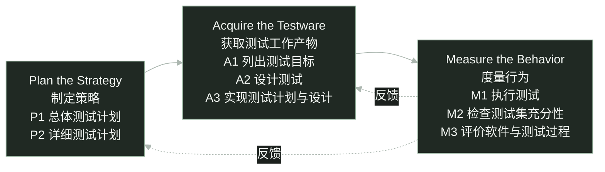

software testing / STEP

<h1 class="cover-title course-cover">STEP 模型 核心理念、测试过程与 Plate 实践</h1>

三个阶段、八项活动，测试怎样贯穿开发

sin6626 · 软件测试课程报告

<!--
大家好，今天介绍 STEP 模型。我们先看为什么测试需要提前介入，再介绍核心理念、三个阶段和八项活动，最后用 Plate 富文本编辑器重构的测试安排帮助理解。
这份报告区分模型本身的内容和课堂示例。退课需求是教学示例，Plate 是项目级辅助案例。Plate 部分依据二〇二六年十月十六日的固定资料快照，不代表今天的团队状态，也不声称团队正式采用了完整 STEP。
-->

---
glow: right
glowOpacity: 0.25
glowHue: 99
glowSeed: 205
clicks: 2
---

# 为什么需要 STEP？

等功能写完才开始测试，需求里的遗漏可能已经进入代码。

教学示例 · 假设退课截止时间为 18:00，以下规则尚待澄清。

<h2>试着设计边界用例</h2>

在 17:59、18:00、18:01 申请退课。

恰好 18:00，应该允许还是拒绝？

<h2>试着设计后续检查</h2>

退课成功后，检查课程剩余名额。

名额会释放吗？何时释放？

预期结果写不出来，就先把需求问清楚。

预防性测试思想 · <a href="https://api.pageplace.de/preview/DT0400.9781580537926_A25416955/preview-9781580537926_A25416955.pdf#page=35" target="_blank">Systematic Software Testing · pp.4–5</a> · 退课情境为教学示例

<!--
假设需求说学生可以在十八点以前退课。先试着列出十七点五十九分、十八点整和十八点零一分的用例。十八点整到底能不能退？如果规则没说清楚，就不能擅自编一个预期。
再检查退课后的名额。是否释放，什么时候释放，失败时怎么办，也需要需求负责人确认。我们设计测试时就发现了需求遗漏，可以在编码前反馈。
原始资料第四至五页用取款需求解释预防性测试。本页换成退课情境，业务规则仍是假设，不能当成已经确认的学校规定。
-->

---
glow: top-right
glowOpacity: 0.25
glowHue: 93
glowSeed: 306
clicks: 1
---

# STEP 的定义与定位

Systematic Test and Evaluation Process

系统化地组织测试与评价， 以预防性测试为导向。

测试规划、测试设计可以从开发早期开始。

作为测试过程的内容参考模型，说明有哪些活动、怎样组织。

同时评价软件表现与测试过程，为后续改进提供依据。

<a href="https://api.pageplace.de/preview/DT0400.9781580537926_A25416955/preview-9781580537926_A25416955.pdf#page=51" target="_blank">Systematic Software Testing · p.20</a> · <a href="https://istqb.org/wp-content/uploads/2024/11/CTAL_TM_2012_Syllabus_v2.0.pdf#page=62" target="_blank">ISTQB CTAL-TM 2012 · §5.7</a>

<!--
STEP 的全称是 Systematic Test and Evaluation Process，可以理解为系统化测试与评价过程。它以预防性测试为导向，组织策略制定、测试工作产物的获取，以及行为度量。
ISTQB 二〇一二年高级测试管理大纲把 STEP 作为内容参考模型介绍。这里强调测试过程需要包含哪些活动，不把它说成给组织评成熟度等级的模型。
STEP 也不等于 TDD。TDD 是先写失败测试、实现通过、再重构的开发循环。STEP 讨论整体测试如何组织，提前设计需求用例并不自动等于 TDD。TDD 的独立定义依据 Martin Fowler，https://martinfowler.com/bliki/TestDrivenDevelopment.html 。
参考原书第二十页和历史大纲第五点七节。原书说明测试规划从需求阶段开始，测试设计与软件设计并行。
-->

---
glow: bottom
glowOpacity: 0.3
glowHue: 87
glowSeed: 411
clicks: 1
---

# STEP 的核心理念

基本前提 · 按 ISTQB 2012 大纲 §5.7 的原文顺序逐项译述。

<ol>
<li>基于需求的测试策略。</li>
<li>测试从生命周期开始时介入。</li>
<li>测试用作需求和使用模型。</li>
<li>测试工作产物的设计引导软件设计。</li>
</ol>
<ol v-click="1" start="5">
<li>更早发现缺陷，或预防缺陷产生。</li>
<li>系统地分析缺陷。</li>
<li>测试人员与开发人员协作。</li>
</ol>

<a href="https://istqb.org/wp-content/uploads/2024/11/CTAL_TM_2012_Syllabus_v2.0.pdf#page=63" target="_blank">ISTQB CTAL-TM 2012 · §5.7 · p.63 · basic premises</a> 七项基本前提，按该大纲原顺序译述。

<!--
这里采用 ISTQB 二〇一二年测试经理大纲第五点七节的七项基本前提，顺序与该节原文一致。它是历史大纲对 STEP 的介绍。
第一项强调测试策略以需求为依据。第二项说明测试从生命周期开始时介入。第三项说明测试可以作为需求和使用方式的模型，通过具体场景表达期望的软件行为。
第四项强调先设计测试工作产物，用它们引导软件设计。在需求规格能够作为输入时，提前设计的测试可以暴露歧义和遗漏。
第五项说明测试关注更早发现和预防缺陷。第六项要求系统地分析缺陷。第七项强调测试人员与开发人员协作。
-->

---
class: step-flow-slide
glow: right
glowOpacity: 0.22
glowHue: 80
glowSeed: 511
clicks: 0
---

# STEP 整体流程

三个阶段、八项活动 · 活动结构不等于严格的执行时间线。

同一层级内、不同层级间，活动都可能交叠。

据 <a href="https://api.pageplace.de/preview/DT0400.9781580537926_A25416955/preview-9781580537926_A25416955.pdf#page=45" target="_blank">原书 p.14 · Table 1-3</a> 重绘活动结构；虚线反馈为说明性补充，非原表箭头。 活动交叠与时序依据 <a href="https://api.pageplace.de/preview/DT0400.9781580537926_A25416955/preview-9781580537926_A25416955.pdf#page=46" target="_blank">pp.15–16 · Figures 1-5 / 1-6</a>。

<!--
原书表一杠三把 STEP 分为三个阶段。制定策略包括总体测试计划与详细测试计划。获取测试工作产物包括列出目标、设计测试、实现计划与设计。度量行为包括执行、检查测试集充分性、评价软件与测试过程。
本页把表格中的活动改画成流程图，方便看清结构。实线说明阶段关系，不表示每个阶段必须全部结束，下一阶段才能开始。
虚线是为说明反馈关系添加的。例如评价后发现目标和设计不足，需要补充工作产物；安排有问题，需要修订计划。虚线不是原书图中已有的箭头。
原书第十五至十六页另外说明执行时机和活动交叠，第九页将单独展示这些时序特点。
-->

---
glow: right
glowOpacity: 0.22
glowHue: 74
glowSeed: 612
clicks: 1
---

# 制定策略 · 总体计划与详细计划

Plan the Strategy · 选择策略，确定测试层级和开展方式。

<h2>P1 制定总体测试计划</h2>

确定总体范围、风险与测试策略。

统筹测试层级、资源和职责。

Master test plan

<h2>P2 制定详细测试计划</h2>

细化对应层级的执行安排。

明确人员、环境、时间及开始和结束条件。

Detailed test plans

详细计划组织测试，A2 再设计具体测试。

<a href="https://api.pageplace.de/preview/DT0400.9781580537926_A25416955/preview-9781580537926_A25416955.pdf#page=45" target="_blank">原书 p.14 · Table 1-3</a>；层级与裁剪见 <a href="https://api.pageplace.de/preview/DT0400.9781580537926_A25416955/preview-9781580537926_A25416955.pdf#page=44" target="_blank">p.13 · Figure 1-4</a>。中文问题说明为译述。

<!--
Plan the Strategy 是原书的阶段名称，可以译为制定策略。原书第十四页说明，这一阶段选择策略，明确测试层级和方式。
P1 建立总体测试计划，统筹项目测试。P2 制定详细测试计划，把安排落实到对应测试层级。原书第十三页说明简单项目可能只需要一两个测试层级，复杂项目则可以有更多层级，具体按项目裁剪。
总体计划和详细计划的活动名称来自表一杠三，页面上的范围、风险、人员和环境等是对计划问题的解释，不是额外的 STEP 活动。
详细计划不等于详细用例。具体输入、操作与预期结果属于后面的测试设计。
-->

---
glow: left
glowOpacity: 0.25
glowHue: 68
glowSeed: 713
clicks: 2
---

# 获取测试工作产物 · 目标、设计与实现

Acquire the Testware · testware 包括测试文档、用例、数据、程序等。

A1

<h2>列出测试目标</h2>

需求、设计与实现为依据

识别并整理要测试的内容， 形成测试目标清单。

A2

<h2>设计测试</h2>

架构与环境，以及具体测试

设计测试架构与环境， 按需求、设计、实现设计测试。

A3

<h2>实现计划与设计</h2>

形成能够执行的测试工作产物

实现测试步骤和程序， 准备配套数据、文件与环境。

假设退课示例 · 先列截止时间目标，再设计边界检查，最后准备课程数据与执行步骤；规则仍需确认。

<a href="https://api.pageplace.de/preview/DT0400.9781580537926_A25416955/preview-9781580537926_A25416955.pdf#page=45" target="_blank">原书 p.14 · Table 1-3</a> · <a href="https://api.pageplace.de/preview/DT0400.9781580537926_A25416955/preview-9781580537926_A25416955.pdf#page=48" target="_blank">pp.17–19 · Work Products of STEP</a>

<!--
Acquire the Testware 可以译为获取测试工作产物。原书第十七页把 testware 定义为测试计划、测试规格、已实现的测试过程、测试用例和测试数据文件等测试产品。获取也包含分析、设计和实现这些产物，不能仅理解为安装工具。
A1 根据需求、设计和实现列出测试目标。A2 不只设计单条用例，还包括测试架构与环境，以及基于需求、设计和实现的测试设计。A3 将这些计划与设计落实为测试步骤、配套数据、文件、环境和必要的支持代码。
以假设退课系统为例，截止时间是一个目标；检查截止前、截止点和截止后是设计；准备课程数据、时间条件和可执行步骤是实现。设计和实现信息出现后，还可以补充接口、状态或代码层面的目标与测试。示例没有真实业务规格，预期结果要以确认后的规则为准。
-->

---
glow: top-right
glowOpacity: 0.25
glowHue: 62
glowSeed: 814
clicks: 2
---

# 度量行为 · 执行、充分性与评价

Measure the Behavior · 执行结果与测试覆盖需要分别检查。

M1

<h2>执行测试</h2>

实际表现符合预期吗？

执行测试、检查结果， 留下记录与问题报告。

M2

<h2>检查测试集充分性</h2>

测试与目标清单怎样对应？

检查需求、设计等清单 与测试的覆盖对应，识别遗漏。

M3

<h2>评价软件与测试过程</h2>

软件与测试过程分别怎样？

评价软件表现， 也评价测试过程与工作产物。

“覆盖已知”是相对于所列清单，不是所有缺陷都已覆盖。

<a href="https://api.pageplace.de/preview/DT0400.9781580537926_A25416955/preview-9781580537926_A25416955.pdf#page=45" target="_blank">原书 p.14 · Table 1-3</a> · 覆盖清单与校准见 <a href="https://api.pageplace.de/preview/DT0400.9781580537926_A25416955/preview-9781580537926_A25416955.pdf#page=51" target="_blank">pp.20–21</a>

<!--
M1 执行测试，检查实际结果并记录问题。M2 检查测试集是否充分。原书第二十至二十一页强调，应把测试与需求、设计、代码等目标清单建立对应，并相对这些清单度量覆盖。
因此用例全部通过与测试充分是不同的问题。目标清单本身遗漏了需求，即使用例覆盖了清单中的每一项，也不能推出遗漏的行为得到验证。
M3 同时评价软件和测试过程。软件目前表现怎样，测试设计、执行和记录又是否有效，需要分别作出有证据支持的评价。
原书表一杠三给出八项活动的名称；这里对充分性检查的解释同时依据第二十至二十一页的覆盖对应关系，不能把方法试验或用例通过率直接当成完整覆盖。
-->

---
glow: right
glowOpacity: 0.22
glowHue: 56
glowSeed: 915
clicks: 2
---

# 测试怎样贯穿软件开发？

同一测试层级内，活动依次展开并可交叠；图中长度不代表工期。

需求规格设计描述软件实现

制定计划

分析测试目标

设计测试

实现测试计划与设计

执行测试

检查测试集充分性

评价软件与测试过程

高层测试可以先设计、后执行；各层级的测试设计也可交叠。

据 <a href="https://api.pageplace.de/preview/DT0400.9781580537926_A25416955/preview-9781580537926_A25416955.pdf#page=47" target="_blank">原书 p.16 · Figure 1-6</a> 重绘；高层测试时序见 <a href="https://api.pageplace.de/preview/DT0400.9781580537926_A25416955/preview-9781580537926_A25416955.pdf#page=46" target="_blank">pp.15–16 · Figure 1-5</a>。 生命周期从需求形成延续到退役，见 <a href="https://istqb.org/wp-content/uploads/2024/11/CTAL_TM_2012_Syllabus_v2.0.pdf#page=62" target="_blank">ISTQB §5.7 · p.62</a>。

<!--
这幅可编辑时序图依据原书第十六页图一杠六重绘，保留活动依次展开、持续交叠的关系。条形长度不表示实际日期、投入或工期，开发输入也不是每项测试只能开始一次的硬性关卡。
计划和目标先展开，再设计测试和实现测试，随后执行、检查充分性并评价。活动可以交叠，不能理解成上一项全部结束后才能开展下一项。
原书第十五页强调，在被测组件的外部、功能或黑盒规格可用时，就能开始基于需求的测试设计，并争取在相应软件详细设计之前完成大部分测试设计。高层级的系统、验收测试以系统需求为输入，可以提前设计。随着设计细化，再补设计相关测试；编码时，再补实现相关测试。
原书第十六页也区分设计顺序与执行顺序。单元、集成、系统和验收测试的执行受到被测软件组装顺序的限制；规划和获取测试工作产物没有同样限制，高层测试集可以先开发、后使用。不同层级的目标分析与设计可以交叠。
历史 ISTQB 大纲第五点七节把生命周期范围写到系统退役。因此发布后仍需随变更维护相应测试，不能把测试贯穿开发理解为发布即结束。
-->

---
glow: bottom-right
glowOpacity: 0.25
glowHue: 49
glowSeed: 1016
clicks: 2
---

# STEP 的特点与优势

原书 Table 1-5 的比较维度 · 反映 2002 年出版时的论述。

<table class="lifecycle-table step-strengths">
<thead><tr><th>维度</th><th>原书列出的 STEP 特点</th></tr></thead>
<tbody>
<tr><td>目标</td><td>以预防缺陷与风险管理为导向。</td></tr>
<tr><td>规划时机</td><td>从需求定义时开始测试规划。</td></tr>
<tr><td>获取时机</td><td>从需求定义时开始获取测试工作产物。</td></tr>
<tr v-click="1"><td>覆盖</td><td>建立测试与目标清单的对应，覆盖相对于清单是已知的。</td></tr>
<tr v-click="2"><td>过程可见性</td><td>测试活动形成文档和工作产物，能够检查和评价。</td></tr>
</tbody>
</table>

提前反馈问题，并让测试结论有可检查的依据。

<a href="https://api.pageplace.de/preview/DT0400.9781580537926_A25416955/preview-9781580537926_A25416955.pdf#page=52" target="_blank">Craig &amp; Jaskiel · Systematic Software Testing (2002) · p.21 · Table 1-5</a> 此处译述 STEP 一列；原书的行业比较不代表今天整个行业的状况。

<!--
这一页逐项对应原书表一杠五的五个比较维度，介绍 STEP 一列的内容。
原书首先强调预防与风险管理，并主张从需求定义时开始规划和获取测试工作产物。提前进行测试设计，有机会在编码前发现需求和设计问题。
随后是已知覆盖，但原文明确限定为相对于列出的目标清单。测试与清单建立对应，才可以说明已经覆盖哪些目标。清单本身仍需要检查。
过程可见性来自各活动形成的工作产物，例如计划、清单、设计、测试集和报告；它们使过程可以被检查和评价。
这是二〇〇二年出版原书中的比较，不能把书中对当时常见行业做法的描述当成今天所有团队的现状，也不把这些特点说成本项目已经测得的收益。
-->

---
glow: left
glowOpacity: 0.25
glowHue: 43
glowSeed: 1117
clicks: 1
---

# 实施条件与适用边界

模型假定有可用的开发信息，并要求按具体项目裁剪。

<h2>需要可用的开发信息</h2>

假定是开发性工作，而非探索性研究。

需求与技术设计信息应当可理解、可用于测试。

尚未明确时，测试也能帮助分析与澄清。

<h2>需要按项目裁剪</h2>

不绑定特定工具、组织或人员配置。

测试层级、任务和产物应随项目调整。

测试工作产物随软件共同设计、构建和维护。

<a href="https://api.pageplace.de/preview/DT0400.9781580537926_A25416955/preview-9781580537926_A25416955.pdf#page=43" target="_blank">原书 p.12 · Elements of STEP</a> · <a href="https://api.pageplace.de/preview/DT0400.9781580537926_A25416955/preview-9781580537926_A25416955.pdf#page=44" target="_blank">p.13 · STEP Architecture</a> · <a href="https://api.pageplace.de/preview/DT0400.9781580537926_A25416955/preview-9781580537926_A25416955.pdf#page=48" target="_blank">p.17 · Work Products</a>

<!--
讨论局限时，先看原书明确写出的使用前提。原书第十二页假定是开发性工作，而不是探索性研究；需求和技术设计信息需要可理解，能够作为测试输入。
这不意味着必须先冻结全部需求。原书同页也说，即使需求和设计尚未明确，STEP 的许多部分仍可使用，而且可以帮助分析和描述需求与设计。实际缺少依据时，需要先澄清，不能凭空写预期。
原书还说明模型不依赖工具，也不要求特定测试组织或人员配置。第十三页要求按具体测试情境裁剪、修订或扩展模型。第十七页说明软件与测试工作产物并行发展，相互支持。
所以它不会替项目自动选好工具、测试层级和资源安排。这些条件说明，实际应用仍需澄清测试依据，并按项目安排合适的测试活动。
-->

---
glow: right
glowOpacity: 0.22
glowHue: 37
glowSeed: 1218
clicks: 2
---

# STEP 可以与其他模型配合吗？

ISTQB §5.7 明确提到 STEP 与 TPI Next 配合的实践。

<h2>STEP · 内容参考模型</h2>

说明测试过程有哪些活动， 以及各活动何时、怎样开展。

帮助具体描述和组织测试过程。

<h2>TPI Next · 成熟度视角</h2>

使用关键领域、检查点与成熟度模型， 评估测试过程并确定改进方向。

帮助了解当前状态和改进重点。

评估与改进方向，可以结合具体活动设计一起使用。

<a href="https://istqb.org/wp-content/uploads/2024/11/CTAL_TM_2012_Syllabus_v2.0.pdf#page=62" target="_blank">ISTQB CTAL-TM 2012 · §5.5 TPI Next / §5.7 STEP · pp.62–63</a> §5.7 记录了 STEP 评估模型与 TPI Next 成熟度模型结合的实践。

<!--
可以结合使用，但应先说明模型各自回答什么问题。ISTQB 二〇一二年大纲把 STEP 作为内容参考模型，关注具体活动及其开展方式。
同一份大纲第五点五节介绍 TPI Next，用关键领域、检查点和成熟度模型评估测试过程并组织改进。第五点七节明确记载，在某些情况下，STEP 评估模型会与 TPI Next 成熟度模型结合使用。
因此可以一边识别过程当前处于什么状态、需要优先改进什么，一边用具体测试活动落实改进。大纲只是记述结合实践，并未给出所有项目必须遵循的标准组合方法。
这页以这一个有直接出处的例子回答能否配合使用，不把内容参考模型与成熟度模型混为同一类别。
-->

---
glow: top-right
glowOpacity: 0.25
glowHue: 31
glowSeed: 1319
clicks: 1
---

# Plate 重构项目背景

富文本编辑器重构，风险分布在多个页面和组件交互中。

<h2>要检查什么？</h2>

共有功能是否保持，新功能是否符合预期。

编辑时的光标、选择、焦点和布局是否正常。

<h2>资料主要记录什么？</h2>

页面范围、测试准备、人工探索与问题追踪。

怎样把发现转成修复、测试和下一轮改进。

用 STEP 分析这些流程点，不等于项目正式全程采用 STEP。

2026-10-16 固定快照 · <a href="/evidence/plate-work-readme.md" target="_blank">Plate 行动指南</a> · <a href="/evidence/plate-source-status.md" target="_blank">来源与状态</a>

<!--
Plate 是富文本编辑器，重构涉及多个页面和组件。单个按钮可以操作，不代表把它放进表格、媒体、菜单或复杂选择中仍然正常，所以测试需要关注交互组合、光标、选择、焦点和布局。
接下来五页用项目级的多个流程点对应 STEP，内容主要是测试如何组织和改进，不围绕一个 Bug 展开。
这些资料是二〇二六年十月十六日保存的快照。我们没有据此确认今天的状态，也不能由测试准备记录倒推原始功能开发前已经开展预防性测试，更不声称团队正式采用了完整 STEP 生命周期。
-->

---
glow: right
glowOpacity: 0.22
glowHue: 25
glowSeed: 1420
clicks: 2
---

# Plate 的测试规划

对应制定策略 · 把页面范围和测试策略落实到执行安排。

<h2>总体范围与策略</h2>

列出页面与功能范围，按团队既定顺序安排。

共有功能对照 Slate 或正式版 Plate。

新功能先确认预期，不能只凭版本差异判错。

<h2>详细执行安排</h2>

明确人员分工、页面、浏览器和测试时长。

安排方法组、已知问题复测与记录方式。

确认实际地址、环境与进入条件。

快照中的分工仍待批准，执行表与环境仍需确认。

2026-10-16 方案状态 · <a href="/evidence/plate-work-readme.md" target="_blank">行动指南 · 二、五、六</a> · <a href="/evidence/plate-source-status.md" target="_blank">使用边界</a>

<!--
对应制定策略，先看整体范围和策略。资料区分共有功能与新功能。共有功能有 Slate 或正式版 Plate 作为对照；新功能没有旧版对照时，需要依据明确需求和设计判断，差异本身不等于缺陷。
再看详细安排。需要把页面和范围分给人员，安排浏览器、方法组、时间和已知问题复测，并确认测试地址和环境。
二〇二六年十月十六日快照中的双人分工提案仍等待 Ziad 批准，浏览器、方法组和实际预览地址没有在个人清单中确定，不能说正式测试已经开始。
Plate 资料中的 P1 到 P6 是测试与修复的优先顺序，和 STEP 的 P1 总体计划、P2 详细计划不是同一套编号。本页使用优先级文字，避免混淆。
-->

---
glow: left
glowOpacity: 0.25
glowHue: 19
glowSeed: 1521
clicks: 2
---

# Plate 的测试资源准备

对应获取测试工作产物 · 把测试目标和方法落实到可用资源。

<h2>快照已有准备记录</h2>

页面清单、测试人员指南与记录模板。

页面健康检查脚本、Issue 草稿流程。

Issue 与测试路径、标题、源码 hash 的关联。

<h2>正式执行前仍需确认</h2>

获批分工、轮次执行表和可用测试环境。

设备、浏览器和录屏条件。

若开展方法试验，还需独立预览与密封答案。

准备有记录，不代表验证全绿，也不代表编辑交互已通过。

2026-10-16 固定快照 · <a href="/evidence/plate-work-readme.md" target="_blank">行动指南 · 三至五</a> · <a href="/evidence/plate-test-plan.md" target="_blank">总计划 · 1.1–1.7</a> · <a href="/evidence/plate-source-status.md" target="_blank">使用边界</a>

<!--
对应获取测试工作产物，清单帮助明确目标，指南提供操作和观察方法，模板帮助留下记录，脚本支持环境和页面检查。这些资源不是同一种东西，也不能单靠安装工具完成准备。
资料记录了步骤一点一到一点五的工具与流程准备，包括报告工具、测试源码 hash、Issue 与测试的关联、页面健康检查和指南。但来源状态明确说明部分验证有失败或范围限制，不能说所有检查全绿。
健康检查主要发现页面加载、报错、四〇四和应有编辑器缺失，不证明所有编辑交互正常。hash 能识别测试源码变化，本身不证明测试设计正确。
正式执行仍需确认分工、执行表、设备、浏览器、录屏和环境。若开展植入缺陷的方法试验，还要有隔离的预览和密封答案。这些在快照中仍是待确认事项。
-->

---
glow: top-right
glowOpacity: 0.25
glowHue: 12
glowSeed: 1622
clicks: 2
---

# Plate 的执行流程

对应 M1 · 以下是计划中的流程，不是已经完成的测试结果。

01

<h2>按计划探索</h2>

页面、范围、浏览器和时长

计时人工操作，观察编辑表现， 录屏并记录异常时间点。

02

<h2>整轮后复查</h2>

回到正常 Beta

复查异常是否仍可复现， 核对对照来源与实际结果。

03

<h2>确认问题报告</h2>

证据、预期与复现步骤

整理 Issue 草稿，人工核对， 确认发布后再进入修复。

Plate 计划要求先记发现，完成整轮后再改产品代码。

2026-10-16 待执行安排 · <a href="/evidence/plate-test-guide.md" target="_blank">Tester pass · A session / Find notes / After a round</a> · <a href="/evidence/plate-work-readme.md" target="_blank">行动指南 · 二</a>

<!--
计划中的一场测试，是对一个页面和范围，在指定浏览器内开展的计时录屏访问。测试者现场选择下一步，并观察光标、选择、焦点、菜单位置和布局。发现异常时记录录屏时间点，不能为了恢复焦点而补点鼠标，掩盖异常。
如果这一轮使用带已知问题的预览，整轮结束后再到正常 Beta 复查，区分人为植入的问题与正常产品的问题。可复现的异常整理成 Issue 草稿，人工核对预期和证据后发布。
资料要求先完成整轮场次，再进入修复，避免正式测试途中改产品导致后续页面面对不同版本。这是 Plate 本轮计划的安排，不是 STEP 规定的统一修复时机；快照没有报告这些场次已经执行的次数、通过率或缺陷数。
-->

---
glow: left
glowOpacity: 0.25
glowHue: 6
glowSeed: 1723
clicks: 2
---

# Plate 的评价与改进

主要对应 M3 · 评价软件问题，也评价测试过程与方法。

<h2>方法评价方案 · 待执行</h2>

独立预览植入已知 Bug，答案密封保存。

同等时间比较候选方法与自由探索。

独立评分，再决定方法是否保留。

<h2>问题与回归改进 · 按计划</h2>

确认问题，修复并补能检出该问题的测试。

满足对应层级、浏览器的 CI 覆盖条件后， 才减少该问题的人工复测。

修复进入 Beta 后，再安排下一轮。

用遗漏与结果更新目标、资源和计划，再开始下一轮。

2026-10-16 方案快照，无方法优劣结论 · <a href="/evidence/plate-test-plan.md" target="_blank">总计划 · Round 1's planted-bug trial / 1.9–1.11</a> · <a href="/evidence/plate-test-guide.md" target="_blank">Rechecks</a>

<!--
植入已知问题并比较发现效果，主要是在评价测试方法，属于 M3 的过程评价。页面范围表和 Rechecks 可以帮助检查执行遗漏，但现有资料没有完整的需求、设计目标到测试的覆盖对应，不能据此声称完整实施了 M2。未检出已知问题可以提示方法或场景存在缺口，不能代表所有真实风险。
M3 同时评价产品与测试过程。产品方面，在正常 Beta 复查并确认问题。过程方面，方案准备带已知 Bug 的独立预览和密封答案，在相同时间、浏览器安排和记录条件下比较候选方法与自由探索，由独立评分者对照答案。这个试验在快照中仍待执行，没有方法优劣结论。
确认问题后，要修复并补充能检出缺陷的测试。人工复测只有在测试存在、未跳过、源码身份匹配，并且 CI 在缺陷对应层级或更高层级覆盖后，才按计划减少。浏览器层问题还需要覆盖该问题涉及的浏览器；只有脚本或只有本地通过都不够。测试变化、被删除或失去门禁时，还需要重新检查是否恢复人工复测。
这不等于减少所有探索时间。修复进入 Beta 后才能进入下一轮，根据结果更新范围、目标、资源与安排，形成对 P 和 A 的反馈。以上是根据方案对应模型活动的解释，不是已完成的项目收益。
-->

---
layout: center
glow: bottom
glowOpacity: 0.35
glowHue: 0
glowSeed: 1824
clicks: 0
---

<h1 class="cover-title">谢谢大家</h1>

<!--
谢谢大家。
-->
